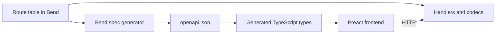

# Cloverleaf: Milestone Plan

Cloverleaf is a proof of concept that tests whether Bend works for general-purpose web programming. It's a full working app that plans daily routes for about 1,000 auto appraisal contractors across the lower 48.

## What we're building

- **Requests:** dealers send appraisals through an external API or the web app, and individuals book through a web form. Either can cancel.
- **Planning:** a nightly national solve assigns each appraisal to a contractor and orders each route as a loop from that contractor's daily start point and back.
- **Same-day changes:** new requests, cancellations and failed stops repair routes during the day.
- **Views:** admins, requesters and contractors each get their own view, with live updates.

### Agreed requirements

| Area | Decision |
|---|---|
| Assignment | The optimizer chooses the contractor. Overlapping zips are candidates |
| Volume | 5,000-10,000 appraisals per day, about 20 minutes each |
| Deadlines | Complete by a date, so work can move between days |
| Priorities | Meet deadlines first, then balance work across contractors |
| Contractor limits | Max hours per day and an availability calendar |
| Overflow | Go outside assigned zips automatically, only to save a deadline, with a cap on extra drive time and a flag for admins |
| Healing | Reorder the route, then backfill from neighbors or later days |
| Contractor app | Route and navigation, status reporting, availability, live location |
| Booking | Web form with a required-by date, then tracking and cancellation by private link |
| Notifications | In-app live updates only |
| Auth | Email and password for people, API keys for organizations |
| Road data | OpenStreetMap, handled entirely in Bend, including reading the raw `.pbf` |
| Geocoding | OpenStreetMap plus Census TIGER, self-hosted |
| Backend | Bend |
| Frontend | TypeScript and Preact, in a real npm project with strict type checking, strict ESLint and Prettier |
| API contract | Bend generates the OpenAPI spec, and the frontend uses a typed client generated from it |
| Data | Realistic synthetic data |
| Hosting | Local machine only, run with Docker Compose in the same shape as a real deployment |
| TLS | Bend has no TLS, so nginx terminates it in front of the backend |
| Repository | Separate `backend/` and `frontend/` folders |
| Scope ends at | Appraisal marked complete. No report or photo workflow |

### Assumptions to correct if wrong

- Planning covers a rolling 7 days. The next day's routes are published after the nightly solve.
- Deadlines mean end of day in the appraisal's local time zone.
- Drive times come from road type and speed limits, with no live traffic.
- Stops that are completed or underway are locked during healing.
- Out-of-zip work is capped at 60 extra drive minutes by default, and admins can change this.
- A dealer's opening hours and an individual's presence at home aren't modeled, because deadlines are date-only.
- The external API is versioned REST with JSON, and creating a request is safe to retry.
- Password resets are done by an admin, because there's no email.
- An individual's tracking link is shown only at booking, for the same reason.
- The browser map uses free public base-map tiles, with route lines drawn from our own road data.

## Measured constraints

Tested on Bend 2.0.39 on this machine (6 cores, 12 threads, 15GB RAM, 926GB free disk).

| Finding | Effect on the design |
|---|---|
| A slow pure job blocks every other request. A trivial request waited 1.41s on 1 thread | Web, solver and road lookups must be separate processes |
| Balanced CPU work scaled 8.5x on 12 threads | The parallel approach is sound, though real solver work still has to prove it |
| About 8,600 small requests per second, with flat memory over 100k requests | Plenty for this API on a simple path. Retest with real handlers |
| `File.size` failed on a 5GB file, and `read_at` takes a `U32` offset | Runtime data files must stay under 4GB, so sharding is required |
| Sequential reads passed 4GB at about 285MB/s with flat 19MB memory (sparse file, 1MB chunks) | The raw `.pbf` can be streamed without loading it all |
| `Array<U32>` costs about 4 bytes per slot. A byte read as a `List` takes one cell, and `String` about 24 bytes per character | Keep large data in arrays or fixed-size records, and convert from lists quickly |
| No U64 in Base, and OSM node IDs no longer fit in 32 bits | IDs need a two-word type, or a remap to compact IDs |
| No HTTP, JSON, crypto, gzip or database in Base | All of these get built in Bend |
| No TLS in Bend | nginx handles it |
| A TCP server with `Nat` fuel passed `ALL PROOFS CHECK` with no `@unsafe`, and 4 billion fuel used only 2MB of memory | The IO shell can stay inside the proof gate, and a server needs no unsafe loop |
| Bend builds from the pinned release tarball with an empty `HOME`, and a failed `--check-only` exits non-zero | A Docker build can fail on bad Bend code |
| Bend's JS target runs sequentially | Fine for the browser validator, but no solving in the browser |
| GPU build produced no `.gpu` file here (no CUDA, clang 18) | CPU only. GPU is out of scope |
| A schema defined as a Bend datatype can set a handler's type, and a handler with a wrong field type failed to compile | API routes are defined as Bend data, so the schema is the single source of truth |
| Bend proved that encoded output always conforms to its schema, on a small schema with strings, numbers, lists and objects | Conformance is a realistic law, not just a hope |
| Bend emitted valid OpenAPI 3.1 that `openapi-typescript` and `openapi-fetch` accepted. `tsc` rejected a misspelled request field and an unknown response field | The contract chain works end to end on one route |
| A Bend module built with `-o .mjs` bundled through Vite into a Preact app under strict `tsc`, using a hand-written declaration file | The proven checker can run in the real frontend build |
| Node 18.19.1 from apt can't run `openapi-typescript`. Node 24.22.2 can | Node 24 is the project version, in `~/.local` here and in the containers |
| Docker isn't installed here, and installing it needs `sudo` | The Compose setup hasn't run on Docker yet. Its nginx config passed a local test on nginx 1.24 |
| `openapi-typescript` 7.13 needs TypeScript 5. npm's default is now TypeScript 7 | Pin TypeScript 5 (5.9.3 tested) |
| `--verdict` needs Lean 4.34.0, which isn't installed | `bend PROOF.bend` still works. Install Lean before relying on the kernel recheck |
| The termination checker rejected a self-call on the same schema in a different mode, and Bend won't infer `Equal.sym`'s arguments | Generators and proofs need some restructuring and explicit arguments. Expect this friction throughout |

Business-rule proof effort is still unmeasured. So far only the small schema law above has been proven, so Milestone 1 tests the real rules first.

## Architecture

- **nginx:** the only public entry point. Terminates TLS, serves the built frontend, and proxies `/api/` to the web process.
- **Web process:** HTTP, API, auth, sessions, live updates. Stays responsive by never doing heavy work.
- **Solver process:** nightly planning and same-day repairs, parallel across cores.
- **Road process:** batch travel-time and geocoding lookups against on-disk data.
- **Pure core:** domain rules, plan validation, event replay and codecs, kept free of IO so `bend PROOF.bend` covers it. The checker also compiles to JS for the browser.
- **Storage:** append-only event log with snapshots, in Bend, with state rebuilt by replay.
- **Frontend:** a Preact single-page app in `frontend/`, talking to the backend only through the public API.

### Repository layout

```text
backend/    Bend code, LAWS.bend, PROOF.bend, Dockerfile
  web/      Web process
  core/     Pure core (planned)
  solver/   Solver process (planned)
  road/     Road process (planned)
frontend/   TypeScript and Preact npm project
deploy/     nginx image and config
compose.yaml, compose.dev.yaml
```

`bend PROOF.bend` runs from `backend/`, and npm scripts run from `frontend/`. `openapi.json` lives in `backend/`, because the backend owns it.

### Local deployment

Compose runs the app the way a real deployment would, so nothing talks to the backend directly. Only nginx publishes ports, and every other service stays on the internal Docker network.

| Service | Role |
|---|---|
| `nginx` | TLS on port 8443, redirect from 8080, static frontend, proxy to the backend |
| `web` | Bend web process, built in a multi-stage image with Bend pinned by checksum |
| `solver`, `road` | Added in Milestones 2 and 3, with a shared data volume |
| `frontend` | Development only. Vite with hot reload behind nginx |

- **Real-world run:** `docker compose up --build` serves the built frontend, and is what Playwright, contract and load tests target.
- **Development:** `docker compose -f compose.yaml -f compose.dev.yaml watch` keeps the same nginx and TLS path, swaps in Vite, and rebuilds the backend on change.
- **Images:** the backend image fails to build if the Bend check fails, and will also run `bend PROOF.bend` once it exists.
- **Certificates:** nginx creates a self-signed certificate in a Docker volume on first start. No key is ever committed.
- **Secrets:** later secrets come from a gitignored `.env` file, never from the images or Compose files.
- **Backend protection:** nginx buffers requests and limits body size, so slow or oversized clients never reach Bend's event loop. Server-Sent Events will need a route with buffering turned off.
- **Road data:** kept in a bind-mounted, gitignored `data/` folder on the Linux filesystem, because it's too large for an image.

### API contract

Every API route is a Bend value in one route table, holding its method, path, auth rule, request schema and response schemas. Everything else comes from that table:

1. **Handlers:** a handler's type is computed from its route, so a wrong response shape doesn't compile.
2. **Codecs:** JSON encoding and decoding are driven by the schema, with laws for conformance and round trips.
3. **Spec:** a Bend program walks the table and writes `openapi.json` (OpenAPI 3.1). The web process also serves it, so dealers can generate their own clients.
4. **Client:** `openapi-typescript` turns the spec into types, and the frontend calls the API through `openapi-fetch`.



An API change is a Bend change. If the frontend's use of the API no longer matches, `tsc` fails.

`openapi.json` and the generated types are committed, and the check regenerates them and fails on any difference. A change to the API therefore always shows up in review.

The spike covered one POST route with strings, numbers, lists and objects. Still to build: path and query parameters, error responses, optional fields, enums, auth schemes, and named components, which the generated TypeScript needs for readable type names.

Live updates use Server-Sent Events, which `openapi-fetch` doesn't handle. Event payloads are still schemas in the route table, and a small typed wrapper around `EventSource` consumes them.

### Frontend project

- **Build:** Vite and Preact, on Node 24 LTS, with TypeScript pinned to 5 for `openapi-typescript`.
- **Type checking:** `strict`, plus `noUncheckedIndexedAccess` and `exactOptionalPropertyTypes`.
- **Linting:** `typescript-eslint` `strictTypeChecked` and `stylisticTypeChecked`, with zero warnings allowed and generated files excluded.
- **Formatting:** Prettier, enforced by the check.
- **Testing:** Vitest for units, and Playwright for each role's workflows, running through nginx.
- **Scripts:** `npm run check` runs type checking, linting, the format check, tests and the spec drift check. `npm run gen:api` regenerates the spec and client.
- **Development:** Vite runs behind nginx in Compose, so the browser always uses the same HTTPS origin as a real deployment.

The browser calls the proven checker through a Bend module built with `-o .mjs`. Its boundary is a single function taking and returning JSON strings, using the same proven codecs as the API. This avoids hand-mapping Bend's constructors in TypeScript. Its small declaration file is written by hand.

### Road data without holding it in RAM

1. Stream the `.pbf` once. Its blocks are compressed independently, so decompression can fan out across cores.
2. Keep only drivable roads, reducing nodes to junctions.
3. Split the network into geographic regions, stored as fixed-size records in files under 4GB.
4. Precompute shortcuts across each region's boundary so long trips don't load every region between them.
5. At solve time, load only regions near the stops and compute travel times only between pairs that could share a route.

Each contractor covers a limited area, so most lookups touch few regions.

### Solving in parallel

Contractor overlaps may chain into one giant national cluster, so we can't count on natural separation. The solver cuts the country into balanced regions, solves those in parallel, then shifts the boundaries and repeats so work can cross them. Balance matters because Bend's scheduler never moves a task once it's assigned.

## What the proofs cover

Proven in `LAWS.bend`, for the pure core:

- Every active appraisal is in exactly one place: a route, the backlog, or the exceptions queue.
- Every route starts and ends at the contractor's start point and visits no stop twice.
- Published routes respect hours, availability and deadlines, or the exception is recorded.
- Out-of-zip work is within the cap and flagged.
- After a cancellation, the appraisal is in no route.
- Healing never changes locked stops, and never makes a valid plan invalid.
- Parallel and sequential selection give the same answer.
- The optimizer never returns a worse score than its input.
- Replaying a snapshot plus later events equals replaying the full log.
- Codecs round-trip.
- Every encoded API response conforms to its route's schema.
- Tenant isolation and role permissions hold for every request.
- Road paths exist in the graph, and their reported cost is correct.

Not proven:

- That routes are optimal. Quality is measured by benchmarks instead.
- That road times match reality.
- That the emitted `openapi.json` means the same thing as the Bend schema. Contract tests check real responses against the spec instead.
- The IO shell, process wiring and frontend. These rely on testing.

## Milestones

Sizes are relative. Each milestone ends with a passing `bend PROOF.bend`, and also `npm run check` once the frontend exists.

### 1. Core model and proof check (M)

Domain types, plan validity, the appraisal lifecycle, and the checker, with a small solver using straight-line distances.

**Done when:** the validity and healing laws are proven, and proof effort has been recorded.
**Go/no-go:** if these laws are too painful, reduce the proof scope before building further.

### 2. Road network (XL)

Gzip-style decompression and protobuf parsing in Bend, then the region pipeline above and batch travel-time queries. Start with one state, then the lower 48.

**Done when:** the full lower-48 build completes on this machine, within 15GB of RAM, and a sample of routes is within an agreed margin of a reference router.
**Go/no-go:** if the national build can't fit, revisit `.pbf` handling or graph detail.

### 3. National solver (L)

Synthetic data generator, nightly multi-day planning, contractor assignment, balance, and capped out-of-zip overflow.

**Done when:** a 10,000-appraisal, 1,000-contractor day solves in a proposed 30 minutes, no feasible deadline is missed, and results beat simple baselines. We'll also measure speedup on real solver work and benchmark against OR-Tools.

### 4. Web platform and API (XL)

HTTP/1.1, JSON, the route table and schema-driven codecs, the OpenAPI generator, event log and snapshots, password and API-key auth, the external API, organizations and roles, and process wiring. Also adds the generated client and contract tests to the existing frontend project, so the contract is proven end to end before the UI is built.

**Done when:** simulated dealer clients can create, read and cancel requests using the generated spec, real responses pass contract tests, a breaking API change fails `tsc`, data survives a crash, and tenant isolation is proven.

### 5. Geocoding (M)

Address lookup from OpenStreetMap and TIGER, including reading TIGER's zip archives, with zip assignment and a review queue for weak matches.

**Done when:** a sample of real addresses meets an agreed match rate, and weak matches are flagged instead of silently misplaced.

### 6. Same-day healing (L)

Cancellations, new requests, failed stops, sick contractors, live location, and backfill from neighbors or later days. Includes a simulator that plays out a full day.

**Done when:** a change produces updated routes within a proposed 5 seconds, locked stops never move, and the API stays responsive during repairs.

### 7. Frontend (L)

A TypeScript and Preact app using the generated API client. Admin view (national map, exceptions, overrides, contractors, metrics), requester view (submit, track, cancel, API keys), public booking and tracking pages, and a mobile-friendly contractor view. Includes live updates and instant drag validation by the proven checker.

**Done when:** each role can complete its full workflow in Playwright tests and in a browser, `npm run check` passes, and the design holds up in a real review.

### 8. Full-day demo and Bend scorecard (M)

A simulated national day from intake to the last completed appraisal, with 1,000 contractors, dealer API traffic, cancellations and live screens, all running through the Compose stack. Includes crash and load testing, then a written verdict on Bend.

**Done when:** the full day runs cleanly on this machine, and the scorecard is finished.

Milestones 5 and 7 can overlap with 4 once the first version of the spec exists.

## Bend scorecard

Tracked from Milestone 1 onward:

- Proof lines per line of code, and how far small rule changes ripple through proofs
- Bugs that proofs caught, and bugs that got past them
- Parallel speedup on real work, not synthetic loops
- Memory and throughput under realistic load
- Amount of infrastructure that had to be written from scratch
- How well Bend fits a normal frontend workflow, including API changes reaching TypeScript and any spec drift found by contract tests
- Developer friction, including compiler errors, missing features and `@unsafe` use

## Main risks

1. **Lower-48 road build:** decompression, parsing and region-building at this scale in Bend is the largest unknown, and 15GB of RAM is tight.
2. **Proof effort:** untested so far, and it could slow every later milestone.
3. **Scale of road data in Bend's memory model:** lists and strings are expensive, so performance depends on staying in arrays.
4. **Geocoding quality:** free address data has gaps, particularly in rural areas.
5. **Phone GPS:** browsers allow geolocation only on trusted HTTPS or localhost. nginx provides HTTPS, but a phone won't trust the self-signed certificate, so a real-phone test needs a certificate the phone trusts. The fleet will use simulated locations.
6. **Local-only hosting:** no real outside dealer can reach the API, so the demo relies on simulated clients.
7. **Schema law at full scale:** the spike's law compared field names by length only, because Base has `String.eq` but no proof that it's reflexive. The real law needs that lemma, and proof effort on the full schema is unknown.
