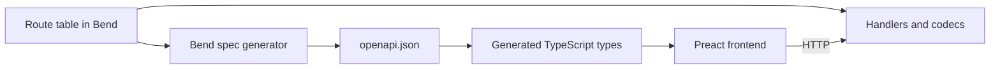

# Cloverleaf: Milestone Plan

Cloverleaf is a proof of concept that tests whether Bend works for general-purpose web programming. It's a full working app that plans daily routes for about 1,000 auto appraisal contractors across the lower 48.

## What we're building

- **Requests:** dealers send appraisals through an external API or the web app, and individuals book through a web form. Either can cancel.
- **Planning:** a nightly national solve assigns each appraisal to a contractor and orders each route as a loop from that contractor's daily start point and back.
- **Same-day changes:** new requests, cancellations and failed stops repair routes during the day.
- **Views:** admins, requesters and contractors each get their own view, with live updates.

### Agreed requirements

| Area | Decision |
|---|---|
| Assignment | The optimizer chooses the contractor. Overlapping zips are candidates |
| States | A contractor works in one state, always. The app plans and routes one state at a time |
| Volume | 5,000-10,000 appraisals per day, about 20 minutes each |
| Deadlines | Complete by a date, so work can move between days |
| Priorities | Meet deadlines first, then balance work across contractors |
| Contractor limits | Max hours per day and an availability calendar |
| Overflow | Go outside assigned zips automatically, only to save a deadline, with a cap on extra drive time and a flag for admins. Never across a state line |
| Healing | Reorder the route, then backfill from neighbors or later days |
| Contractor app | Route and navigation, status reporting, availability, live location |
| Booking | Web form with a required-by date, then tracking and cancellation by private link |
| Notifications | In-app live updates only |
| Auth | Email and password for people, API keys for organizations |
| Road data | OpenStreetMap. A Node script decodes the raw `.pbf` into fixed-size road records before deploy, and Bend handles everything after that |
| Memory | The whole stack runs in 8GB, the top of a typical deployment for this kind of app, with a hard cap on each service |
| Geocoding | OpenStreetMap plus Census TIGER, self-hosted |
| Backend | Bend |
| Frontend | TypeScript and Preact, in a real npm project with strict type checking, strict ESLint and Prettier |
| API contract | Bend generates the OpenAPI spec, and the frontend uses a typed client generated from it |
| Data | Realistic synthetic data |
| Hosting | Local machine only, run with Docker Compose in the same shape as a real deployment |
| TLS | Bend has no TLS, so nginx terminates it in front of the backend |
| Repository | Separate `backend/` and `frontend/` folders |
| Scope ends at | Appraisal marked complete. No report or photo workflow |

### Assumptions to correct if wrong

- Planning covers a rolling 7 days. The next day's routes are published after the nightly solve.
- Deadlines mean end of day in the appraisal's local time zone.
- Drive times come from road type and speed limits, with no live traffic.
- Stops that are completed or underway are locked during healing, and form the front of the route.
- A cancellation is refused once the stop is underway, because a locked stop can't leave its route.
- Out-of-zip work is capped at 60 extra drive minutes by default, and admins can change this. The cap counts unlocked out-of-zip stops only. Without that exception a cancellation next to a locked out-of-zip stop could push a route over the cap with no way to heal it.
- A failed stop goes straight back to the backlog, which is what retries it.
- A sick contractor's route closes to new work and its open stops go to the backlog. Updating the calendar itself is left to Milestone 6.
- A dealer's opening hours and an individual's presence at home aren't modeled, because deadlines are date-only.
- The external API is versioned REST with JSON, and creating a request is safe to retry.
- Password resets are done by an admin, because there's no email.
- An individual's tracking link is shown only at booking, for the same reason.
- The browser map uses free public base-map tiles, with route lines drawn from our own road data.

## Measured constraints

Tested on Bend 2.0.39 on this machine (6 cores, 12 threads, 15GB RAM, 926GB free disk).

| Finding | Effect on the design |
|---|---|
| A slow pure job blocks every other request. A trivial request waited 1.41s on 1 thread | Web, solver and road lookups must be separate processes |
| Balanced CPU work scaled 8.5x on 12 threads | The parallel approach is sound, though real solver work still has to prove it |
| About 8,600 small requests per second, with flat memory over 100k requests | Plenty for this API on a simple path. Retest with real handlers |
| `File.size` failed on a 5GB file, and `read_at` takes a `U32` offset | Runtime data files must stay under 4GB, so sharding is required |
| Sequential reads passed 4GB at about 285MB/s with flat 19MB memory (sparse file, 1MB chunks) | The raw `.pbf` can be streamed without loading it all |
| `Array<U32>` costs about 4 bytes per slot. A byte read as a `List` takes one cell, and `String` about 24 bytes per character | Keep large data in arrays or fixed-size records, and convert from lists quickly |
| No U64 in Base, and OSM node IDs no longer fit in 32 bits | The road build remaps IDs to compact `U32`s, so Bend never sees an OSM ID |
| No HTTP, JSON, crypto, gzip or database in Base | HTTP, JSON, crypto and the database get built in Bend. Gzip isn't needed, because decoding map data moved to Node |
| No TLS in Bend | nginx handles it |
| A TCP server with `Nat` fuel passed `ALL PROOFS CHECK` with no `@unsafe`, and 4 billion fuel used only 2MB of memory | The IO shell can stay inside the proof gate, and a server needs no unsafe loop |
| Bend builds from the pinned release tarball with an empty `HOME`, and a failed `--check-only` exits non-zero | A Docker build can fail on bad Bend code |
| Bend's JS target runs sequentially | Fine for the browser validator, but no solving in the browser |
| GPU build produced no `.gpu` file here (no CUDA, clang 18) | CPU only. GPU is out of scope |
| A schema defined as a Bend datatype can set a handler's type, and a handler with a wrong field type failed to compile | API routes are defined as Bend data, so the schema is the single source of truth |
| Bend proved that encoded output always conforms to its schema, on a small schema with strings, numbers, lists and objects | Conformance is a realistic law, not just a hope |
| Bend emitted valid OpenAPI 3.1 that `openapi-typescript` and `openapi-fetch` accepted. `tsc` rejected a misspelled request field and an unknown response field | The contract chain works end to end on one route |
| A Bend module built with `-o .mjs` bundled through Vite into a Preact app under strict `tsc`, using a hand-written declaration file | The proven checker can run in the real frontend build |
| Node 18.19.1 from apt can't run `openapi-typescript`. Node 24.22.2 can | Node 24 is the project version, in `~/.local` here and in the containers |
| Docker isn't installed here, and installing it needs `sudo` | The Compose setup hasn't run on Docker yet. Its nginx config passed a local test on nginx 1.24 |
| `openapi-typescript` 7.13 needs TypeScript 5. npm's default is now TypeScript 7 | Pin TypeScript 5 (5.9.3 tested) |
| `--verdict` needs exactly Lean 4.34.0 (installed through elan). The first run compiles the kernel in about 24s and caches it in `~/.bend/bendtt/`, so later runs take about 1s | A fresh machine or CI needs elan with that toolchain, or `$BENDTT` set to a built kernel. Plain `bend PROOF.bend` needs neither |
| The termination checker rejected a self-call on the same schema in a different mode, and Bend won't infer `Equal.sym`'s arguments | Generators and proofs need some restructuring and explicit arguments. Expect this friction throughout |
| `Nat` runs as a 48-bit immediate with O(1) arithmetic, as fast as `U32` (100M mixed operations in 0.67s), and aborts past 2^48 instead of wrapping | Domain numbers are `Nat`, which needs no bit-level lemmas. Ids, minutes and days all fit |
| A universally quantified hypothesis is an affine closure, so a proof can use it once. Equality proofs are `Data` and reusable | Bag equality is stated over a concrete list (`agree`), not as a for-all |
| A literal fuel such as `improve(3n, ..)` inside a def makes the checker unroll it when comparing terms. It hangs with no message | Fuel and tuning reach solver defs as parameters |
| 10,000 appraisals, 1,000 contractors and 7 days plan in 18.3s on 1 thread and 5.3s on 12, within 44MB, on straight-line times | The 30-minute target looks reachable, before road lookups are added |
| Forking one search 2^2 ways gave 1.3x on 4,000 jobs, and 2^6 ways gave 2.9x, with no cost on one thread | Tasks never move, so unevenly loaded work needs far more tasks than cores. Measure fork depth instead of guessing |
| The proven checker built with `-o .mjs` ran under Node, accepting a good plan and rejecting a duplicated and a lost appraisal | The browser validator works through plain JS constructors |
| A real inflate in Bend matched zlib's checksums on three Delaware `.pbf` blocks. One thread produced 103-159MB/s, 2.5 to 4x slower than zlib. 12 threads produced 457-831MB/s, a 4.4x to 6.2x speedup. Way blocks were the slowest | Bend can do this work, but the spike was all `@unsafe` and cost far more code than Node, so `.pbf` decoding moved to Node. Kept for the scorecard |
| With 1MB chunks consumed as they arrive, a real 2GB file read at about 350MB/s and wrote at about 213MB/s, with memory flat at 19MB. Holding whole files as `List`s managed only 71-83MB/s, because the heap kept growing | Disk IO through `List`s is fine if chunks stay small and short-lived. Never hold a batch longer than it takes to decode |
| Bend's heap never returns memory to the OS. Freed blocks are reused only at the same power-of-two size: a 60M-cell list (940MB) freed before a 2^28-slot array (1,050MB) peaked at 1,988MB, while the same list built three times stayed at 939MB | Peak use per size is held until exit. Use fixed-size arrays, and give each build pass its own process |
| Bend has no heap limit. Under a cgroup cap, `systemd-run -p MemoryMax=300M` killed a 1GB run with no error from Bend | Going over budget means being killed, so caps must be tested on real runs. `MemoryMax` works on this machine and makes a usable gate |
| A streaming build with no sorting reproduced the in-memory Georgia graph exactly (710,444 nodes, 885,408 edges). No refs lacked a node and no IDs were out of order | The design below works on real data |
| `scripts/road-build.mjs` built the full 12.2GB US file in 659s on one thread, peaking at 564MB under a hard 1GB cap, with no missing refs. That's 20.9M nodes and 26.9M edges, then 49 state folders totaling 3.2GB. An independent reader found no bad references or shapes in any state | The lower-48 build fits in far less than 8GB, and needs no dependency beyond Node |
| In Georgia (358MB), service roads are 44% of road nodes and 68% of graph nodes | Dropping service roads shrinks the graph 3x |
| Stopping a graph at the state line gave wrong drive times. Compared with a graph of the whole South, across 53M Georgia pairs, no margin left 1.85% of near-border pairs unreachable. 20km still left trips up to 26 minutes too slow. At 40km every pair matched exactly, for 37% more graph | Each state's graph runs 40km past its border. This was measured on Georgia only, and Geofabrik's state extracts can't be used, because they stop at about the border |
| Bend's road search matched Node's settled counts exactly on real Georgia and Texas graphs. A one-hour search took 38-41ms on one thread, about 1.5x slower than Node, and Texas loaded in 0.22s | A whole state fits in memory and searches fast, so regions and an overlay aren't needed. This spike was `@unsafe`, read adjacency arrays built by Node, and used a hand-written def per array read |
| Each search lane needs its own copy of the graph, because an array has one owner. A Texas lane takes 134MB, so 4 lanes peak at 546MB, and 8 would go over the 1GB cap | `road` works out what fits from the array sizes and refuses more before it copies anything. Lanes range from 4 in Texas to 64 in small states |
| The spike's 800 searches on Georgia took 30.2s on 1 lane, 16.4s on 2, 15.9s on 4 and 6.0s on 8. Lanes weren't uneven. The runtime skips no-fork defs while a fork tree grows, but runs any def that can fork, so a lane inside a forking def's base case ran during the grow, on only 2 rows of threads. With a direct parallel call to a no-fork def, the same work took 19.9s, 11.7s, 6.7s and 4.3s on the real graph, against 17.9s, 9.9s, 9.9s and 6.3s for the old shape in the same run | A fork tree must end in a parallel call to a def that never forks. Expect 4.4x from 8 lanes. The rest of the gap is memory: 6 cores, with a shared 32MB L3 under graphs larger than that |
| A road search written as one `Nat`-fuel def per loop passes the gate and compiles to flat loops, with the last read passed as a pair parameter. Texas took 34.7ms per search on one thread against the `@unsafe` spike's 38-41ms, and matched Node's settled counts exactly | Passing the gate cost no speed. Go/no-go for Milestone 2 passes |
| Bend builds Texas's adjacency from `edges.bin` in 1.45s, in two passes. All 49 states loaded and searched under a hard 1GB cap, peaking at 152MB on one lane | The road process needs nothing precomputed but the road records |
| A heap capacity of 2^20 entries is far above what real searches use: 530 entries at most in Delaware | Capacity is checked on every push and a full heap fails the search, so nothing wraps |
| A Texas matrix of 1,000 stops took 12.1s on 4 lanes, with every reached cell's path walked and checked, peaking at 600MB. All 1,000,000 cells matched an independent Node implementation | Checking every reported time costs almost nothing, because the 1-hour limit leaves only 8% of cells reachable |
| A bad lane depth was killed by a 2GB cgroup cap within 30s, cloning the graph without limit. Run with no cap, the same command is the likely cause of two reboots of the whole WSL machine | Going over budget can take the machine down, not just the process. Pure budget checks run before any allocation, and every binary runs under a `MemoryMax` cap with `MemorySwapMax=0` |
| Solving 10,000 jobs as 48 population-weighted states took 1.6s in total on one thread, against 19.3s as one national instance, and the largest state took 0.34s. These were separate runs on synthetic data with straight-line times | One solve per state is about 12x cheaper, and could finish in about 0.34s on 6 or more cores against 5.3s today |
| Geofabrik's `.pbf` is sorted by type: Delaware has 350 node blocks, then 40 way blocks, then 1 relation block | One pass can't work, because a node's use isn't known until after it's been read |
| `us-latest.osm.pbf` is 12.2GB. In Delaware, data expands 2.55x, the largest block is 1.6MB, road nodes are 25.8% of all nodes, and node IDs reach 34 bits | The US file can only be read sequentially, and most nodes can be dropped early |
| Random `Array<U32>` reads took 1.5ns at 2^12 slots, 8.6ns at 2^24 and 10.6ns at 2^28. Allocating 2^28 slots took 0.9s | Arrays behave like flat memory, so large lookup tables are practical. Reuse them instead of allocating per block |

Proof effort for the real rules is now measured. See the scorecard.

## Architecture

- **nginx:** the only public entry point. Terminates TLS, serves the built frontend, and proxies `/api/` to the web process.
- **Web process:** HTTP, API, auth, sessions, live updates. Stays responsive by never doing heavy work.
- **Solver process:** nightly planning and same-day repairs, parallel across cores.
- **Road process:** batch travel-time and geocoding lookups against on-disk data.
- **Road build:** a Node script, run before deploy, that decodes the `.pbf` into fixed-size records. It's the one part of the backend's data path outside Bend. The app never runs it, and only its output reaches production.
- **Pure core:** domain rules, plan validation, event replay and codecs, kept free of IO so `bend PROOF.bend` covers it. The checker also compiles to JS for the browser.
- **Storage:** append-only event log with snapshots, in Bend, with state rebuilt by replay.
- **Frontend:** a Preact single-page app in `frontend/`, talking to the backend only through the public API.

### Repository layout

```text
backend/    Bend code, LAWS.bend, PROOF.bend, Dockerfile
  web/      Web process
  core/     Pure core: types, lifecycle, plan checker, healing, planner
  proof/    Lemmas behind PROOF.bend
  test/     Concrete scenarios the laws don't cover
  solver/   Benchmark shell and synthetic instances, later the solver process
  road/     Road process: graph build, search, path checks, snapping and lanes, with an IO shell
frontend/   TypeScript and Preact npm project
scripts/    Node scripts that run before deploy, with their tests
deploy/     nginx image and config
compose.yaml, compose.dev.yaml
```

`bend PROOF.bend` runs from `backend/`, and npm scripts run from `frontend/`. `openapi.json` lives in `backend/`, because the backend owns it.

### Local deployment

Compose runs the app the way a real deployment would, so nothing talks to the backend directly. Only nginx publishes ports, and every other service stays on the internal Docker network.

| Service | Role |
|---|---|
| `nginx` | TLS on port 8443, redirect from 8080, static frontend, proxy to the backend |
| `web` | Bend web process, built in a multi-stage image with Bend pinned by checksum |
| `road` | Batch lookups, run one state at a time under a Compose profile, each run its own process, because Bend's heap never shrinks. Shares the backend image |
| `solver` | Added in Milestone 3, with the shared data volume |
| `road-build` | One-shot Node job that turns the `.pbf` into per-state road records. Has its own image, so the Bend images stay free of Node. Runs under a Compose profile, not on `up` |
| `frontend` | Development only. Vite with hot reload behind nginx |

- **Real-world run:** `docker compose up --build` serves the built frontend, and is what Playwright, contract and load tests target.
- **Development:** `docker compose -f compose.yaml -f compose.dev.yaml watch` keeps the same nginx and TLS path, swaps in Vite, and rebuilds the backend on change.
- **Images:** the backend image fails to build if `bend PROOF.bend`, the Bend checks or the scenarios fail. `road-build` has its own image from `scripts/`. None of this has run on Docker yet.
- **Certificates:** nginx creates a self-signed certificate in a Docker volume on first start. No key is ever committed.
- **Secrets:** later secrets come from a gitignored `.env` file, never from the images or Compose files.
- **Backend protection:** nginx buffers requests and limits body size, so slow or oversized clients never reach Bend's event loop. Server-Sent Events will need a route with buffering turned off.
- **Road data:** kept in a bind-mounted, gitignored `data/` folder on the Linux filesystem, because it's too large for an image.

### API contract

Every API route is a Bend value in one route table, holding its method, path, auth rule, request schema and response schemas. Everything else comes from that table:

1. **Handlers:** a handler's type is computed from its route, so a wrong response shape doesn't compile.
2. **Codecs:** JSON encoding and decoding are driven by the schema, with laws for conformance and round trips.
3. **Spec:** a Bend program walks the table and writes `openapi.json` (OpenAPI 3.1). The web process also serves it, so dealers can generate their own clients.
4. **Client:** `openapi-typescript` turns the spec into types, and the frontend calls the API through `openapi-fetch`.



An API change is a Bend change. If the frontend's use of the API no longer matches, `tsc` fails.

`openapi.json` and the generated types are committed, and the check regenerates them and fails on any difference. A change to the API therefore always shows up in review.

The spike covered one POST route with strings, numbers, lists and objects. Still to build: path and query parameters, error responses, optional fields, enums, auth schemes, and named components, which the generated TypeScript needs for readable type names.

Live updates use Server-Sent Events, which `openapi-fetch` doesn't handle. Event payloads are still schemas in the route table, and a small typed wrapper around `EventSource` consumes them.

### Frontend project

- **Build:** Vite and Preact, on Node 24 LTS, with TypeScript pinned to 5 for `openapi-typescript`.
- **Type checking:** `strict`, plus `noUncheckedIndexedAccess` and `exactOptionalPropertyTypes`.
- **Linting:** `typescript-eslint` `strictTypeChecked` and `stylisticTypeChecked`, with zero warnings allowed and generated files excluded.
- **Formatting:** Prettier, enforced by the check.
- **Testing:** Vitest for units, and Playwright for each role's workflows, running through nginx.
- **Scripts:** `npm run check` runs type checking, linting, the format check, tests and the spec drift check. `npm run gen:api` regenerates the spec and client.
- **Development:** Vite runs behind nginx in Compose, so the browser always uses the same HTTPS origin as a real deployment.

The browser calls the proven checker through a Bend module built with `-o .mjs`. Its boundary is a single function taking and returning JSON strings, using the same proven codecs as the API. This avoids hand-mapping Bend's constructors in TypeScript. Its small declaration file is written by hand.

### Road data in 8GB

The whole stack has to fit in 8GB, so memory is a fixed budget, not a result of how much data there is. Build memory depends on fixed array sizes, never on the size of the country. Nothing sorts: node IDs and way positions are direct addresses into fixed arrays, so the only work is streaming files in the right order.

The build runs before deploy, so it can run on another machine and ship only its output. It writes about 4.3GB of temporary files for the US.

`scripts/road-build.mjs` runs four passes:

1. **Ways.** Stream the `.pbf` and keep drivable roads other than service roads. Give each node reference a position, its index in the stream of references. Append the node ID's low 24 bits, an endpoint flag and the position to a file for that ID's partition of 2^24 IDs. A partition number plus 24 bits covers every OSM ID, so nothing needs 64 bits.
2. **Nodes.** The file is sorted by ID, so node blocks arrive in partition order and only one partition is active at a time. Load its references into two fixed bitmaps, seen and junction, and use rank to give each needed node a slot in a fixed coordinate array. Stream the nodes and keep only those seen, which skips about 88% of them. Write each reference's position, coordinates and junction number to a position partition of about 4M references. A junction's number is its partition's base plus its rank, which replaces OSM IDs with compact `U32`s.
3. **Edges.** A position is a direct index, so each partition loads into a fixed array with no sort. Walk the ways in order, cut them at junctions, and write each edge's length, drive time, class and direction.

4. **States.** Contractors never cross a state line, so each state gets its own folder of files, numbered on their own. One state at a time, rasterize its outline, spread it 40km, and keep the junctions and edges inside. A road near a border lands in both states' files, which is why 49 folders hold about 1.3x the national data.

Each folder has three files of little-endian `U32` words, each under 4GB so Bend can read them with `read_at`. The header of the script defines the format.

| File | Record | Georgia | Texas, the largest |
|---|---|---|---|
| `nodes.bin` | 2 words: lat, lon | 8MB | 17MB |
| `edges.bin` | 6 words: from, to, meters, deciseconds, flags, shape | 29MB | 67MB |
| `shapes.bin` | 2 words: lat, lon | 74MB | 125MB |

There are no regions or overlay. A state's graph comes to at most 49MB of adjacency, so the road process loads a whole state into memory and runs a bounded search from each stop. A trip never leaves its state, so nothing needs to cross the country.

`road matrix` takes stops as coordinates, snaps each to its nearest node through a hash grid of 0.02 degree cells, and writes a matrix of drive times. Service roads stay out of the routing graph. A stop on one snaps to the nearest public road, which slightly understates the last few hundred meters. Road shapes stay in their own file, read only when drawing a route.

Roads closed to cars stay out of the graph, using the most specific of `motorcar`, `motor_vehicle`, `vehicle` and `access` as OSRM's car profile does. `private` and `no` close a road. A stop on one snaps to the nearest public road, like a stop on a service road. Default speeds by road class are still first guesses, to be tuned against the reference router.

At runtime, the road process holds one state at a time. The nightly solve knows all its lookups up front, so it loads each state once, runs its searches, and writes that state's travel-time matrices. The solver reads those instead of touching the graph. Same-day repairs need only a few searches in the contractor's state, and still need a long-running road service in Milestone 6. Lanes are set per state from its size, because each lane copies the graph, and `road` refuses a depth that doesn't fit a 900MB budget.

Scaling from Texas, about 11,000 one-hour searches a night take about 7 minutes on one thread, before any parallel speedup. A repair needing 10 searches takes about 0.4s.

Caps, set with Compose `mem_limit` and an equal `memswap_limit`. `road` and `road-build` have been checked on real runs with `systemd-run`, but not yet on Docker:

| Service | Cap | Basis |
|---|---|---|
| `nginx` | 64MB | Static files and proxying |
| `web` | 512MB | Unmeasured until Milestone 4 |
| `solver` | 2GB | 44MB today on straight-line times, before matrices and events |
| `road` | 1GB | Texas ran 4 lanes in 546MB, and 600MB on a 1,000-stop matrix. All 49 states pass on one lane |
| `road-build` | 1GB | 564MB on the full US. Run only to refresh data |
| OS and page cache | About 3.3GB | Whatever is left |

### Solving in parallel

Contractors never cross a state line, so the national solve is one independent `Instance` per state, with no boundaries to shift or repair. An instance covers one state, so overflow can't leave it, and no solve can affect another.

States run in parallel, assigned to lanes by estimated cost, because Bend's scheduler never moves a task once it's assigned and California is 60 times Wyoming. The largest state sets the finish time, so large states can also fork internally.

## What the proofs cover

Proven so far in `LAWS.bend`, for the pure core:

- Every active appraisal is in exactly one place: a route, the backlog, or the exceptions queue.
- Every route starts and ends at the contractor's start point and visits no stop twice.
- Published routes respect hours, availability and deadlines, or the exception is recorded.
- Out-of-zip work is within the cap and flagged.
- After a cancellation, the appraisal is in no route.
- Healing never changes locked stops, and never makes a valid plan invalid.
- Every stop on a route is in the contractor's state, including out-of-zip work.
- A request from another state changes nothing.
- Parallel and sequential selection give the same answer.
- A reported drive time is the exact cost of a path that really walks the graph from source to destination, within the limit.
- Searches and lookups leave the graph unchanged, and reading an array changes nothing.
- Dealing work to lanes loses nothing and merges back in order.
- The lane depth the shell allows fits its memory budget.
- The optimizer never returns a worse score than its input.
- The planner only considers open routes, on or before the deadline, with the hours left, and only urgent work leaves its zips.

Road times use the same idea as `publish`. The search isn't proven to find anything, so a lookup walks the path it left behind against the graph and reports only what that walk confirms. A search bug shows up as a refused lookup, which the shell won't report, never as a wrong time. `Array` is a tree in Base, so laws can reason about reads directly. An array can't be copied in a proof, so `proof/road.bend` proves the Base clone gives two provably equal live copies and builds on that.

Healing is proven by construction: every edit rebuilds the route through `Route.remake`, so no runtime guard is involved, apart from the check that a reorder holds the same stops. The planner is the opposite. It isn't proven to build a valid plan. `publish` runs the proven checker on the result and falls back to the trivial plan, so what leaves is always valid, but a planner bug would show up as an empty plan instead of a failed proof.

Still to prove:

- Replaying a snapshot plus later events equals replaying the full log.
- Codecs round-trip.
- Every encoded API response conforms to its route's schema.
- Tenant isolation and role permissions hold for every request.

Not proven:

- That routes are optimal. Quality is measured by benchmarks instead.
- That a road search finds the shortest time, or finds a path at all. `test/scenario.bend` compares it with Bellman-Ford, and `scripts/check-road-matrix.mjs` with a separate Dijkstra.
- That the adjacency build or snapping is right. They rely on the scenarios and the same script.
- That the planner places work at all. A valid plan may leave everything in the backlog, so `test/scenario.bend` covers this.
- That the planner handles the tightest deadline first. Also covered by the scenarios.
- That road times match reality. No law looks inside the travel time function, so swapping in real road times changes no proof.
- That the emitted `openapi.json` means the same thing as the Bend schema. Contract tests check real responses against the spec instead.
- The IO shell, process wiring and frontend. These rely on testing.
- `.pbf` decoding. The Node road build sits outside the proofs and `--verdict`, so it relies on its tests and the reference router. Laws about road data can only assume what its records say.
- That a state's graph gives the true drive time. The 40km margin was measured on Georgia only.

## Milestones

Sizes are relative. Each milestone ends with a passing `bend PROOF.bend`, and also `npm run check` once the frontend exists.

### 1. Core model and proof check (M)

Domain types, plan validity, the appraisal lifecycle, and the checker, with a small solver using straight-line distances.

**Done when:** the validity and healing laws are proven, and proof effort has been recorded.
**Go/no-go:** if these laws are too painful, reduce the proof scope before building further.
**Status:** done. All 40 laws pass `bend PROOF.bend`, and the result is go: the proof scope stays as planned. `bend PROOF.bend --verdict` also passes with the proven kernel, on Lean 4.34.0.

### 2. Road network (XL)

The Node road build is done for the whole country, one folder per state, and its Compose job is written. The road process builds adjacency and answers batch travel-time queries in Bend. What's left is the comparison with a reference router.

**Done when:** the road process serves lookups for its largest state under a hard 1GB cap, and a sample of routes is within an agreed margin of a reference router. The lower-48 road build already completes under its hard 1GB cap.
**Go/no-go:** if a gate-passing search is too slow or too large for Texas, reduce lanes first, then graph detail.
**Status:** go. The gate-passing search beats the spike on Texas and fits the cap. Private roads are filtered out. Still open: which reference router to use and its margin, the default speeds that depend on it, and a first real run of Compose.

### 3. National solver (L)

Synthetic data generator, one nightly multi-day solve per state, contractor assignment, balance, and capped out-of-zip overflow.

**Done when:** a 10,000-appraisal, 1,000-contractor day solves in a proposed 30 minutes, no feasible deadline is missed, and results beat simple baselines. We'll also measure speedup on real solver work and benchmark against OR-Tools.

### 4. Web platform and API (XL)

HTTP/1.1, JSON, the route table and schema-driven codecs, the OpenAPI generator, event log and snapshots, password and API-key auth, the external API, organizations and roles, and process wiring. Also adds the generated client and contract tests to the existing frontend project, so the contract is proven end to end before the UI is built.

**Done when:** simulated dealer clients can create, read and cancel requests using the generated spec, real responses pass contract tests, a breaking API change fails `tsc`, data survives a crash, and tenant isolation is proven.

### 5. Geocoding (M)

Address lookup from OpenStreetMap and TIGER, with zip assignment and a review queue for weak matches. Reading OSM addresses and TIGER's zip archives happens in Node before deploy, like the road build.

**Done when:** a sample of real addresses meets an agreed match rate, and weak matches are flagged instead of silently misplaced.

### 6. Same-day healing (L)

Cancellations, new requests, failed stops, sick contractors, live location, and backfill from neighbors or later days. Includes a simulator that plays out a full day.

**Done when:** a change produces updated routes within a proposed 5 seconds, locked stops never move, and the API stays responsive during repairs.

### 7. Frontend (L)

A TypeScript and Preact app using the generated API client. Admin view (national map, exceptions, overrides, contractors, metrics), requester view (submit, track, cancel, API keys), public booking and tracking pages, and a mobile-friendly contractor view. Includes live updates and instant drag validation by the proven checker.

**Done when:** each role can complete its full workflow in Playwright tests and in a browser, `npm run check` passes, and the design holds up in a real review.

### 8. Full-day demo and Bend scorecard (M)

A simulated national day from intake to the last completed appraisal, with 1,000 contractors, dealer API traffic, cancellations and live screens, all running through the Compose stack. Includes crash and load testing, then a written verdict on Bend.

**Done when:** the full day runs cleanly on this machine, and the scorecard is finished.

Milestones 5 and 7 can overlap with 4 once the first version of the spec exists.

## Bend scorecard

Tracked from Milestone 1 onward:

- Proof lines per line of code, and how far small rule changes ripple through proofs
- Bugs that proofs caught, and bugs that got past them
- Parallel speedup on real work, not synthetic loops
- Memory and throughput under realistic load
- Amount of infrastructure that had to be written from scratch
- How well Bend fits a normal frontend workflow, including API changes reaching TypeScript and any spec drift found by contract tests
- Developer friction, including compiler errors, missing features and `@unsafe` use

### Milestone 1 results

**Proof effort**

| Measure | Result |
|---|---|
| Laws | 40, in 369 lines |
| Core code | 1,833 lines |
| Proofs | 6,698 lines and 386 lemmas, or 3.7 proof lines per line of code |
| Checking everything | 0.5s |
| `@unsafe` or foreign code | None |
| `--verdict` | Passes on Lean 4.34.0, about 1s once the kernel is cached |

Proofs took most of the milestone's work, but they were steady. Once the design was right, most failures were one-line fixes to a proof script, and no law had to be weakened. The hard part was design: healing proofs are short because `Route.remake` makes every rebuilt route valid by construction. Without that, each of the six edits would have needed its own validity proof.

**How far changes ripple**

- Adding one field to the published audit touched 20 lines of core and 47 lines of proof, all in 3 equality lemmas. No healing proof changed.
- Moving the planner's constants into a `Tuning` record changed 2 lines of proof.

**Bugs**

Proofs caught no bug in the code as written. Every failed proof was a mistake in the proof script. The value showed up in two other places:

- **Design:** stating the cap law exposed that a whole-route cap can't survive a cancellation next to a locked stop. That changed the rule before any code existed.
- **Injected bugs:** we injected 25 bugs. `bend PROOF.bend` caught 22, and `test/scenario.bend` caught the other 3: all-zero drive times, the wrong deadline order, and a planner that drops every job.

Mutation testing also caught a bad law. `candidate_fits_route` said only that `Select.fits` passed, so a bug inside `fits` changed the law along with the code, and "planner ignores deadlines" got through. It became three laws stated in plain numbers. A law that restates the code proves nothing, so laws need checking too.

A failed proof doesn't always mean a false law. Some injected bugs were caught because a proof script stopped matching the code, and a harmless refactor would trip the same check.

**Parallel speedup on real work**

| Work | 1 thread | Best | Speedup |
|---|---|---|---|
| Plan check, 4,000 jobs | 24ms | 5ms on 12 threads | 4.8x |
| Assigning jobs, 10,000 jobs | 16.2s | 4.2s on 12 threads | 3.8x |
| Whole run, 10,000 jobs | 18.3s | 5.3s on 12 threads | 3.5x |
| Polishing routes, 10,000 jobs | 1,311ms | 465ms on 8 threads | 2.8x |

Output was identical at every thread count. This machine has 6 physical cores, so 12 threads flatters the thread count.

Two things decided these numbers:

- **Copying:** selecting through `take` and `drop` copied the route list for every job and gave no speedup. A balanced tree fixed that and nearly halved the single-thread time.
- **Fork depth:** we cut the search from 2^4 lanes to 2^2 on a hunch, and the 4-thread speedup fell from 2.3x to 1.3x. A sweep showed the opposite was true, with the best results around 2^6. A job's candidates cluster on a few routes and tasks never move, so over-splitting is the only way to balance them.

**Friction**

- **Rewriting:** `%e` replaces the right side of `e` with its left, which is easy to get backwards. It caused about ten failed attempts.
- **No inference or tactics:** every `Equal.trans` spells out each term, so proof lines run long. This is the main reason for the 3.7 ratio.
- **For-all hypotheses:** they can only be used once, which forced the `agree` workaround. This was the most surprising limit.
- **Silent hangs:** literal fuel in a def hangs the checker with no message or timeout. Finding it took bisecting the proof file law by law.
- **Missing lemmas:** Base has almost nothing on `Nat` order or addition, so `proof/logic.bend` holds about 900 lines of basics.
- **No work stealing:** a task stays where it starts, so load balance is on the programmer. Over-splitting works, but the right depth came from a sweep and may not hold for other work.
- **Match placement:** `match` can't follow a `let` or a rewrite on the same parameter, so lets move into each arm.
- **Eager evaluation:** `Bool.pick` evaluates both arms, and banned mutual recursion means thunks for lazy branches.
- **Good:** error messages show the expected and observed terms in context, and were nearly always enough. Checking is fast enough to run after every edit.

### Milestone 2 inflate spike

A throwaway decoder, written to test whether inflate belongs in Bend. Its decoder is about 400 lines. Timing and checksums are in the measured constraints above.

- **Compiler bug:** an `@unsafe` IO loop split across two defs passed the checker, then generated invalid C (`spin_19` undeclared) and failed in clang. It happened twice, both times through a partial application handed to `IO.bind`. One recursive def with pure helpers got around it.
- **Memory:** the heap's rules (no return to the OS, reuse only at the same size, no limit) aren't in the guide. We found them by reading the generated C, and they decided the road build's design.
- **Against Node:** the Node road build covers the wire decoder, the two-pass join, edge building and output in about 540 lines, because `node:zlib`, typed arrays and file offsets are built in. An earlier version without output worked on its first run. The Bend inflate alone is about 400 lines and 101 defs, and took several fixes, some for bugs in the spike and some for Bend's limits.
- **Outcome:** `.pbf` decoding moved to Node. This is a real result for the scorecard: Bend managed the work and the speed, but byte-level format code cost too much in a language with no built-in decompression, in-place reads or mutual recursion. It also means Bend's proofs stop at the road records.
- **Array reads:** a read returns a pair, and a pair from a computed value can't be destructured in the same def, so every read needs a new def. This took the decoder from 60 defs to 101, and we used a script to generate them.
- **Mutual recursion:** a decode loop is naturally a set of states that tail-call each other, which only works under `@unsafe`. A version that passes the gate has to fold them into one `Nat`-fuel def with a mode argument.
- **Good:** a plain fork tree over identical blocks scaled 4.4x to 6.2x on 12 threads with no tuning.

### Milestone 2 road process

Written from the spike, with no `@unsafe` in it.

| Measure | Result |
|---|---|
| Laws | 50, up from 42 |
| Road code | 1,101 lines of pure Bend and a 378-line IO shell |
| Proofs | 1,057 lines and 157 defs and lemmas, or 1.0 proof line per line of pure code |
| Proof gate | Still 0.65s, and `--verdict` passes |
| `@unsafe` or foreign code | None |

**Bugs**

Proofs caught no bug in the code as written. Three real bugs got past them or sat outside them, and each was found another way:

- **Crash:** `road` took any lane depth. A failed build hidden by `| tail` left a stale binary running with new arguments, which read 36000 as a lane depth and cloned the graph without limit. The same command under a cap was an OOM kill, and uncapped it's the likely cause of the machine rebooting twice. No law could flag a check that didn't exist. `lanes_fit_the_budget` was written afterwards.
- **Row order:** the shell reversed its points one time too many, so every row was in the wrong place. Rows matched across lane counts, and the laws don't cover the shell. `check-road-matrix.mjs` caught it on the first run.
- **Fuel:** the path walk spent 3 fuel per hop and was given 1 per node. Real graphs are too large to hit this. A 5-node scenario hit it, and the lookup was refused instead of being wrong, which is the design working.

A self-review also caught an off-by-one in the budget before it ran. A mutation later showed that the new law catches it.

**Injected bugs**

We injected 29. `bend PROOF.bend` caught 20 and `test/scenario.bend` caught 9, after adding scenarios for 2 that first survived. Heap order is one: the search drains its heap and re-expands improved nodes, so a broken heap still gives right answers, only slower. The new scenario counts settled nodes, which is how that shows up. Two of the 20 tripped `keep`, which mirrors the search's arms, not a law, so they count as a proof script no longer matching.

**Friction**

- **Arrays in proofs:** a read needs the array live, evidence must come from live code, and a proof can't use an array twice. Erased lets don't help, since dead evidence doesn't count. The way out was to prove `Array.clone` makes provably equal copies, then thread a copy through each proof.
- **Scheduler rule:** the guide says lanes must be balanced, but not that a lane must be a direct parallel call to a no-fork def. We found that by reading the generated C and confirmed it with a control build.
- **Heap limit:** no limit means a sizing mistake can reboot the machine. This is the most serious operational risk found so far.
- **Rewriting:** `%e` direction again cost about eight failed attempts.
- **Small traps:** `+` on a field of a dependent pair fails with "cannot infer", so such fields go through a helper. Base takes names like `Key` and `Word`, and `is` is a keyword. `match xs ys` with a wildcard doesn't reduce when the other side is unknown, so proofs split those cases out.
- **Good:** a loop with a mode argument and a pair parameter is both gate-passing and faster than the spike's chain of defs. The search-keeps-the-graph proof was generated from the search's own arms and passed first try. Templates gave one file-reading fold for four record types.

### One state per contractor

The rule went in as a design choice, not a check on every edit. An instance is one state, and existing laws already put every stop in the instance and every crew in its list, so the law follows from them.

| Measure | Result |
|---|---|
| Laws | 42, up from 40 |
| Core code changed | About 70 lines |
| Proof code changed | About 340 lines, most of it adding one field to two equality lemmas |
| Healing and route proofs changed | None |
| Injected bugs | 10, all caught by `bend PROOF.bend` |
| Bugs caught in the code as written | None |

Some injected bugs were caught because a proof script stopped matching the code, as in Milestone 1, so "caught" doesn't always mean a law was broken.

**Friction**

- **Parallel reads:** an array has one owner, so lanes can't share a read-only graph without `@unsafe`. Copying it is the largest memory cost in the road search.

## Main risks

1. **Bend's unlimited heap:** the road process passes the gate within its cap, but one bad size can fill the machine with no warning. Budget checks and memory caps are the only defense, and each new process needs its own.
2. **Proof effort:** measured at 3.7 proof lines per line of code, and manageable. The risk now is the verbosity of proofs at web scale, not whether they can be done.
3. **Scale of road data in Bend's memory model:** lists and strings are expensive, so performance depends on staying in arrays.
4. **Geocoding quality:** free address data has gaps, particularly in rural areas.
5. **Phone GPS:** browsers allow geolocation only on trusted HTTPS or localhost. nginx provides HTTPS, but a phone won't trust the self-signed certificate, so a real-phone test needs a certificate the phone trusts. The fleet will use simulated locations.
6. **Local-only hosting:** no real outside dealer can reach the API, so the demo relies on simulated clients.
7. **Schema law at full scale:** the spike's law compared field names by length only, because Base has `String.eq` but no proof that it's reflexive. The real law needs that lemma, and proof effort on the full schema is unknown.
