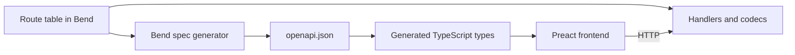

# Cloverleaf: Milestone Plan

Cloverleaf is a proof of concept that tests whether Bend works for general-purpose web programming. It's a full working app that plans daily routes for about 1,000 auto appraisal contractors across the lower 48.

## What we're building

- **Requests:** dealers send appraisals through an external API or the web app, and individuals book through a web form. Either can cancel.
- **Planning:** a nightly national solve assigns each appraisal to a contractor and orders each route as a loop from that contractor's daily start point and back.
- **Same-day changes:** new requests, cancellations and failed stops repair routes during the day.
- **Views:** admins, requesters and contractors each get their own view, with live updates.

### Agreed requirements

| Area | Decision |
|---|---|
| Assignment | The optimizer chooses the contractor. Overlapping zips are candidates |
| States | A contractor works in one state, always. The app plans and routes one state at a time |
| Volume | 5,000-10,000 appraisals per day, about 20 minutes each |
| Deadlines | Complete by a date, so work can move between days |
| Priorities | Meet deadlines first, then balance work across contractors |
| Contractor limits | Max hours per day and an availability calendar |
| Overflow | Go outside assigned zips automatically, only to save a deadline, with a cap on extra drive time and a flag for admins. Never across a state line |
| Healing | Reorder the route, then backfill from neighbors or later days |
| Contractor app | Route and navigation, status reporting, availability, live location |
| Booking | Web form with a required-by date, then tracking and cancellation by private link |
| Notifications | In-app live updates only |
| Auth | Email and password for people, API keys for organizations |
| Road data | OpenStreetMap. A Node script decodes the raw `.pbf` into fixed-size road records before deploy, and Bend handles everything after that |
| Memory | The whole stack runs in 8GB, the top of a typical deployment for this kind of app, with a hard cap on each service |
| Geocoding | OpenStreetMap plus Census TIGER, self-hosted |
| Backend | Bend |
| Frontend | TypeScript and Preact, in a real npm project with strict type checking, strict ESLint and Prettier |
| API contract | Bend generates the OpenAPI spec, and the frontend uses a typed client generated from it |
| Data | Realistic synthetic data |
| Hosting | Local machine only, run with Docker Compose in the same shape as a real deployment |
| TLS | Bend has no TLS, so nginx terminates it in front of the backend |
| Repository | Separate `backend/` and `frontend/` folders |
| Scope ends at | Appraisal marked complete. No report or photo workflow |

### Assumptions to correct if wrong

- Planning covers a rolling 7 days. The next day's routes are published after the nightly solve.
- Deadlines mean end of day in the appraisal's local time zone.
- Drive times come from road type and speed limits, with no live traffic.
- Stops that are completed or underway are locked during healing, and form the front of the route.
- A cancellation is refused once the stop is underway, because a locked stop can't leave its route.
- Out-of-zip work is capped at 60 extra drive minutes by default, and admins can change this. The cap counts unlocked out-of-zip stops only. Without that exception a cancellation next to a locked out-of-zip stop could push a route over the cap with no way to heal it.
- A failed stop goes straight back to the backlog, which is what retries it.
- A sick contractor's route closes to new work and its open stops go to the backlog. Updating the calendar itself is left to Milestone 6.
- A dealer's opening hours and an individual's presence at home aren't modeled, because deadlines are date-only.
- The external API is versioned REST with JSON, and creating a request is safe to retry.
- Password resets are done by an admin, because there's no email.
- An individual's tracking link is shown only at booking, for the same reason.
- The browser map uses free public base-map tiles, with route lines drawn from our own road data.

## Measured constraints

Tested on Bend 2.0.39 on this machine (6 cores, 12 threads, 15GB RAM, 926GB free disk).

| Finding | Effect on the design |
|---|---|
| A slow pure job blocks every other request. A trivial request waited 1.41s on 1 thread | Web, solver and road lookups must be separate processes |
| Balanced CPU work scaled 8.5x on 12 threads | The parallel approach is sound, though real solver work still has to prove it |
| About 8,600 small requests per second, with flat memory over 100k requests | Plenty for this API on a simple path. Retest with real handlers |
| `File.size` failed on a 5GB file, and `read_at` takes a `U32` offset | Runtime data files must stay under 4GB, so sharding is required |
| Sequential reads passed 4GB at about 285MB/s with flat 19MB memory (sparse file, 1MB chunks) | The raw `.pbf` can be streamed without loading it all |
| `Array<U32>` costs about 4 bytes per slot. A byte read as a `List` takes one cell, and `String` about 24 bytes per character | Keep large data in arrays or fixed-size records, and convert from lists quickly |
| No U64 in Base, and OSM node IDs no longer fit in 32 bits | The road build remaps IDs to compact `U32`s, so Bend never sees an OSM ID |
| No HTTP, JSON, crypto, gzip or database in Base | HTTP, JSON, crypto and the database get built in Bend. Gzip isn't needed, because decoding map data moved to Node |
| No TLS in Bend | nginx handles it |
| A TCP server with `Nat` fuel passed `ALL PROOFS CHECK` with no `@unsafe`, and 4 billion fuel used only 2MB of memory | The IO shell can stay inside the proof gate, and a server needs no unsafe loop |
| Bend builds from the pinned release tarball with an empty `HOME`, and a failed `--check-only` exits non-zero | A Docker build can fail on bad Bend code |
| Bend's JS target runs sequentially | Fine for the browser validator, but no solving in the browser |
| GPU build produced no `.gpu` file here (no CUDA, clang 18) | CPU only. GPU is out of scope |
| A schema defined as a Bend datatype can set a handler's type, and a handler with a wrong field type failed to compile | API routes are defined as Bend data, so the schema is the single source of truth |
| Bend proved that encoded output always conforms to its schema, on a small schema with strings, numbers, lists and objects | Conformance is a realistic law, not just a hope |
| Bend emitted valid OpenAPI 3.1 that `openapi-typescript` and `openapi-fetch` accepted. `tsc` rejected a misspelled request field and an unknown response field | The contract chain works end to end on one route |
| A Bend module built with `-o .mjs` bundled through Vite into a Preact app under strict `tsc`, using a hand-written declaration file | The proven checker can run in the real frontend build |
| Node 18.19.1 from apt can't run `openapi-typescript`. Node 24.22.2 can | Node 24 is the project version, in `~/.local` here and in the containers |
| Docker isn't installed here, and installing it needs `sudo` | The Compose setup hasn't run on Docker yet. Its nginx config passed a local test on nginx 1.24 |
| `openapi-typescript` 7.13 needs TypeScript 5. npm's default is now TypeScript 7 | Pin TypeScript 5 (5.9.3 tested) |
| `--verdict` needs exactly Lean 4.34.0 (installed through elan). The first run compiles the kernel in about 24s and caches it in `~/.bend/bendtt/`, so later runs take about 1s | A fresh machine or CI needs elan with that toolchain, or `$BENDTT` set to a built kernel. Plain `bend PROOF.bend` needs neither |
| The termination checker rejected a self-call on the same schema in a different mode, and Bend won't infer `Equal.sym`'s arguments | Generators and proofs need some restructuring and explicit arguments. Expect this friction throughout |
| `Nat` runs as a 48-bit immediate with O(1) arithmetic, as fast as `U32` (100M mixed operations in 0.67s), and aborts past 2^48 instead of wrapping | Domain numbers are `Nat`, which needs no bit-level lemmas. Ids, minutes and days all fit |
| A universally quantified hypothesis is an affine closure, so a proof can use it once. Equality proofs are `Data` and reusable | Bag equality is stated over a concrete list (`agree`), not as a for-all |
| A literal fuel such as `improve(3n, ..)` inside a def makes the checker unroll it when comparing terms. It hangs with no message | Fuel and tuning reach solver defs as parameters |
| 10,000 appraisals, 1,000 contractors and 7 days plan in 18.3s on 1 thread and 5.3s on 12, within 44MB, on straight-line times | The 30-minute target looks reachable, before road lookups are added |
| Forking one search 2^2 ways gave 1.3x on 4,000 jobs, and 2^6 ways gave 2.9x, with no cost on one thread | Tasks never move, so unevenly loaded work needs far more tasks than cores. Measure fork depth instead of guessing |
| The proven checker built with `-o .mjs` ran under Node, accepting a good plan and rejecting a duplicated and a lost appraisal | The browser validator works through plain JS constructors |
| A real inflate in Bend matched zlib's checksums on three Delaware `.pbf` blocks. One thread produced 103-159MB/s, 2.5 to 4x slower than zlib. 12 threads produced 457-831MB/s, a 4.4x to 6.2x speedup. Way blocks were the slowest | Bend can do this work, but the spike was all `@unsafe` and cost far more code than Node, so `.pbf` decoding moved to Node. Kept for the scorecard |
| With 1MB chunks consumed as they arrive, a real 2GB file read at about 350MB/s and wrote at about 213MB/s, with memory flat at 19MB. Holding whole files as `List`s managed only 71-83MB/s, because the heap kept growing | Disk IO through `List`s is fine if chunks stay small and short-lived. Never hold a batch longer than it takes to decode |
| Bend's heap never returns memory to the OS. Freed blocks are reused only at the same power-of-two size: a 60M-cell list (940MB) freed before a 2^28-slot array (1,050MB) peaked at 1,988MB, while the same list built three times stayed at 939MB | Peak use per size is held until exit. Use fixed-size arrays, and give each build pass its own process |
| Bend has no heap limit. Under a cgroup cap, `systemd-run -p MemoryMax=300M` killed a 1GB run with no error from Bend | Going over budget means being killed, so caps must be tested on real runs. `MemoryMax` works on this machine and makes a usable gate |
| A streaming build with no sorting reproduced the in-memory Georgia graph exactly (710,444 nodes, 885,408 edges). No refs lacked a node and no IDs were out of order | The design below works on real data |
| `scripts/road-build.mjs` built the full 12.2GB US file in 659s on one thread, peaking at 564MB under a hard 1GB cap, with no missing refs. That's 20.9M nodes and 26.9M edges, then 49 state folders totaling 3.2GB. An independent reader found no bad references or shapes in any state | The lower-48 build fits in far less than 8GB, and needs no dependency beyond Node |
| In Georgia (358MB), service roads are 44% of road nodes and 68% of graph nodes | Dropping service roads shrinks the graph 3x |
| Stopping a graph at the state line gave wrong drive times. Compared with a graph of the whole South, across 53M Georgia pairs, no margin left 1.85% of near-border pairs unreachable. 20km still left trips up to 26 minutes too slow. At 40km every pair matched exactly, for 37% more graph | Each state's graph runs 40km past its border. This was measured on Georgia only, and Geofabrik's state extracts can't be used, because they stop at about the border |
| Bend's road search matched Node's settled counts exactly on real Georgia and Texas graphs. A one-hour search took 38-41ms on one thread, about 1.5x slower than Node, and Texas loaded in 0.22s | A whole state fits in memory and searches fast, so regions and an overlay aren't needed. This spike was `@unsafe`, read adjacency arrays built by Node, and used a hand-written def per array read |
| Each search lane needs its own copy of the graph, because an array has one owner. A Texas lane takes 134MB, so 4 lanes peak at 546MB, and 8 would go over the 1GB cap | `road` works out what fits from the array sizes and refuses more before it copies anything. On turn graphs, a Texas lane takes 536MB, so Texas and California get 1 lane |
| The spike's 800 searches on Georgia took 30.2s on 1 lane, 16.4s on 2, 15.9s on 4 and 6.0s on 8. Lanes weren't uneven. The runtime skips no-fork defs while a fork tree grows, but runs any def that can fork, so a lane inside a forking def's base case ran during the grow, on only 2 rows of threads. With a direct parallel call to a no-fork def, the same work took 19.9s, 11.7s, 6.7s and 4.3s on the real graph, against 17.9s, 9.9s, 9.9s and 6.3s for the old shape in the same run | A fork tree must end in a parallel call to a def that never forks. Expect 4.4x from 8 lanes. The rest of the gap is memory: 6 cores, with a shared 32MB L3 under graphs larger than that |
| A road search written as one `Nat`-fuel def per loop passes the gate and compiles to flat loops, with the last read passed as a pair parameter. Texas took 34.7ms per search on one thread against the `@unsafe` spike's 38-41ms, and matched Node's settled counts exactly | Passing the gate cost no speed. Go/no-go for Milestone 2 passes |
| Bend builds Texas's adjacency from `edges.bin` in 1.45s, in two passes. All 49 states loaded and searched under a hard 1GB cap, peaking at 152MB on one lane | The road process needs nothing precomputed but the road records |
| A heap capacity of 2^20 entries is far above what real searches use: 530 entries at most in Delaware | Capacity is checked on every push and a full heap fails the search, so nothing wraps |
| A Texas matrix of 1,000 stops took 12.1s on 4 lanes, with every reached cell's path walked and checked, peaking at 600MB. All 1,000,000 cells matched an independent Node implementation | Checking every reported time costs almost nothing, because the 1-hour limit leaves only 8% of cells reachable |
| Against OSRM v6.0.0's car profile, with our first-guess speeds, our times ran 24% fast and 0.2% of Georgia trips were within 10% | Default speeds and the 80% factor on posted limits now come from OSRM's car profile (BSD-2-Clause, credited in `scripts/OSRM-LICENSE.txt`) |
| After that, the share of trips within 10% of OSRM was 99.4% in Georgia (11,663 trips), 98.7% in central Texas (29,093) and 97.7% in Delaware (45,037). Ours ran a median 2.5-3% faster, with no turn or traffic signal delays. Trips under 5 minutes did worst, 62-79% within | Passed the agreed bar, 90% of trips within 10% of OSRM. Turns came next |
| In Delaware, 3 of 300 sample points could be reached but led nowhere, because their only exit was a private road we leave out. That cost 374 trips | The build drops strongly connected pieces under 1,000 junctions, OSRM's threshold, so stops never snap into them. Texas lost 1.7% of its junctions |
| With OSRM's turn costs and its delays for signals, stop and give-way signs, the median ratio to OSRM became 0.999-1.000. Within 10%: Georgia 99.7% (9,825 trips), central Texas 99.8% (28,113), Delaware 99.2% (45,757). Trips under 5 minutes rose to 95-97%, and no trip was missed | Searches run on a turn graph. To the Bend search it's an ordinary graph, so no law or proof changed |
| A Texas turn graph has 9.4M nodes and 21.3M arcs, against 2.0M and 5.4M before. A search takes 82ms on one lane, against 47ms. A 1,000-stop matrix took 94.6s on one lane, peaking at 584MB, and matched the separate checker in every cell | Turns roughly double search time and quadruple memory. Contraction Hierarchies would buy that back |
| A Georgia outlier ran 14 minutes slow because the only short way in was a 130m one-lane bridge tagged `highway=service` | Leaving service roads out costs the odd detour. Rare enough to accept for now |
| OSRM needed 10.3GB to preprocess Georgia plus a 50km margin, and 4.9GB for central Texas | A whole Texas couldn't be compared under a safe cap, so the comparison used a central region with points 50km inside it |
| A bad lane depth was killed by a 2GB cgroup cap within 30s, cloning the graph without limit. Run with no cap, the same command is the likely cause of two reboots of the whole WSL machine | Going over budget can take the machine down, not just the process. Pure budget checks run before any allocation, and every binary runs under a `MemoryMax` cap with `MemorySwapMax=0` |
| Solving 10,000 jobs as 48 population-weighted states took 1.6s in total on one thread, against 19.3s as one national instance, and the largest state took 0.34s. These were separate runs on synthetic data with straight-line times | One solve per state is about 12x cheaper, and could finish in about 0.34s on 6 or more cores against 5.3s today |
| Geofabrik's `.pbf` is sorted by type: Delaware has 350 node blocks, then 40 way blocks, then 1 relation block | One pass can't work, because a node's use isn't known until after it's been read |
| `us-latest.osm.pbf` is 12.2GB. In Delaware, data expands 2.55x, the largest block is 1.6MB, road nodes are 25.8% of all nodes, and node IDs reach 34 bits | The US file can only be read sequentially, and most nodes can be dropped early |
| The national solve on road times, 1,000 contractors and 10,000 appraisals in 49 states, took 2.2s on 12 threads and 8.7s on one, a 4.0x speedup, peaking at 58MB. Loading every state's instance and matrix took 2.1s, and checking every plan 0.6s. The 49 road matrices took 563s in total, Texas 102s of it | The whole nightly pipeline takes about 9.5 minutes against the proposed 30, and almost all of it is road searches |
| Forking the states 2^1 or 2^2 ways was slower than not forking them at all (5.6-6.6s against 4.0-4.5s), and 2^3 to 2^4 was fastest (2.1-3.0s), on 12 threads, in two repeated sweeps | California is about a third of the work. With few forks it shares a leaf that also forks inside, and that runs on a couple of threads while the tree grows. The solver forks 2^4 ways |
| With a one-hour search limit, 7-26% of a state's pairs were in reach, and nearly all of DC's and Rhode Island's | Missing pairs take the straight-line estimate, never under the limit. Trips between stops on one route are short, so this rarely matters, but rural states lean on it |
| Against OR-Tools 9.12 given 120s a state, on identical times and rules, the Bend planner placed as many or more appraisals in Delaware, Georgia, Florida and Texas, and drove 16-23% more. OR-Tools stays in zip and minimises drive only, while the Bend planner rescues deadlines out of zip and also spreads work | Route quality has room to improve, for example with relocate and exchange moves between routes. The Bend solve takes 2.2s for the country, against 120s a state for OR-Tools |
| Random `Array<U32>` reads took 1.5ns at 2^12 slots, 8.6ns at 2^24 and 10.6ns at 2^28. Allocating 2^28 slots took 0.9s | Arrays behave like flat memory, so large lookup tables are practical. Reuse them instead of allocating per block |

Proof effort for the real rules is now measured. See the scorecard.

## Architecture

- **nginx:** the only public entry point. Terminates TLS, serves the built frontend, and proxies `/api/` to the web process.
- **Web process:** HTTP, API, auth, sessions, live updates. Stays responsive by never doing heavy work.
- **Solver process:** nightly planning and same-day repairs, parallel across cores.
- **Road process:** batch travel-time and geocoding lookups against on-disk data.
- **Road build:** a Node script, run before deploy, that decodes the `.pbf` into fixed-size records. It's the one part of the backend's data path outside Bend. The app never runs it, and only its output reaches production.
- **Pure core:** domain rules, plan validation, event replay and codecs, kept free of IO so `bend PROOF.bend` covers it. The checker also compiles to JS for the browser.
- **Storage:** append-only event log with snapshots, in Bend, with state rebuilt by replay.
- **Frontend:** a Preact single-page app in `frontend/`, talking to the backend only through the public API.

### Repository layout

```text
backend/    Bend code, LAWS.bend, PROOF.bend, Dockerfile
  web/      Web process
  core/     Pure core: types, lifecycle, plan checker, healing, planner
  proof/    Lemmas behind PROOF.bend
  test/     Concrete scenarios the laws don't cover
  solver/   Solver process: file reader, report, baselines and IO shell
  road/     Road process: graph build, search, path checks, snapping and lanes, with an IO shell
frontend/   TypeScript and Preact npm project
scripts/    Node scripts that run before deploy or for benchmarks, with their tests
deploy/     nginx image and config
compose.yaml, compose.dev.yaml
```

`bend PROOF.bend` runs from `backend/`, and npm scripts run from `frontend/`. `openapi.json` lives in `backend/`, because the backend owns it.

The web process is split the same way as the others. `web/json.bend`, `web/schema.bend`, `web/api.bend`, `web/store.bend`, `web/utf8.bend` and `web/openapi.bend` are pure, and `web/main.bend` and `web/spec.bend` are the IO shells. `npm run gen:api` runs `bend web/spec.bend` and then `openapi-typescript`, writing `backend/openapi.json` and `frontend/src/api/schema.ts`. `npm run check` and the backend image both fail if either is out of date.

### Local deployment

Compose runs the app the way a real deployment would, so nothing talks to the backend directly. Only nginx publishes ports, and every other service stays on the internal Docker network.

| Service | Role |
|---|---|
| `nginx` | TLS on port 8443, redirect from 8080, static frontend, proxy to the backend |
| `web` | Bend web process, built in a multi-stage image with Bend pinned by checksum. Its event log and snapshot live in the `appraisals` volume at `/data` |
| `road` | Batch lookups, run one state at a time under a Compose profile, each run its own process, because Bend's heap never shrinks. Its image carries the road data, and jobs read and write files in `./data/jobs` |
| `solver` | The nightly national solve, one run per night under a Compose profile, reading each state's instance and road matrix from `./data/jobs` and writing each plan beside them |
| `road-build` | One-shot Node job that refreshes the cached road data in `./data/road`. Has its own image, so the Bend images stay free of Node. Runs under a Compose profile, not on `up` |
| `frontend` | Development only. Vite with hot reload behind nginx |

- **Real-world run:** `docker compose up --build` serves the built frontend, and is what Playwright, contract and load tests target.
- **Development:** `docker compose -f compose.yaml -f compose.dev.yaml watch` keeps the same nginx and TLS path, swaps in Vite, and rebuilds the backend on change.
- **Images:** `backend/Dockerfile` builds from the repo root into three images, `web`, `road` and `solver`, and fails if `bend PROOF.bend`, the Bend checks or the scenarios fail. All three have built and run on Docker Desktop, and the national solve ran in the `solver` image under its 2GB cap. `web` and `nginx` have run together under Compose in a Linux sandbox, where the contract and crash tests passed through nginx. The `road` image wasn't built there, because it needs the 30GB data rebuild.
- **Certificates:** nginx creates a self-signed certificate in a Docker volume on first start. No key is ever committed.
- **Secrets:** come from a gitignored `.env` file, never from the images or Compose files. The first is `CLOVERLEAF_ADMIN_KEY`, which Compose passes to the web process.
- **Backend protection:** nginx buffers requests and limits body size, so slow or oversized clients never reach Bend's event loop. Server-Sent Events will need a route with buffering turned off.
- **Road data:** part of the `road` image, at `/road/<state>`. A plain `docker build` fetches the US extract and rebuilds the data from scratch, as a deployed image should. Local Compose runs set `ROAD_DATA=local` and copy the cached, gitignored `data/road` instead, which takes about 30 seconds instead of half an hour. The image is about 10GB.

### API contract

Every API route is a Bend value in one route table, holding its method, path, auth rule, request schema and response schemas. Everything else comes from that table:

1. **Handlers:** a handler's type is computed from its route, so a wrong response shape doesn't compile.
2. **Codecs:** JSON encoding and decoding are driven by the schema, with laws for conformance and round trips.
3. **Spec:** a Bend program walks the table and writes `openapi.json` (OpenAPI 3.1). The web process also serves it, so dealers can generate their own clients.
4. **Client:** `openapi-typescript` turns the spec into types, and the frontend calls the API through `openapi-fetch`.



An API change is a Bend change. If the frontend's use of the API no longer matches, `tsc` fails.

`openapi.json` and the generated types are committed, and the check regenerates them and fails on any difference. A change to the API therefore always shows up in review.

Built so far: request bodies, path parameters, error responses, optional fields, enums, named components, and Bearer auth schemes with each route's security and its 401 and 403. Still to build: query parameters.

Live updates use Server-Sent Events, which `openapi-fetch` doesn't handle. Event payloads are still schemas in the route table, and a small typed wrapper around `EventSource` consumes them.

### Frontend project

- **Build:** Vite and Preact, on Node 24 LTS, with TypeScript pinned to 5 for `openapi-typescript`.
- **Type checking:** `strict`, plus `noUncheckedIndexedAccess` and `exactOptionalPropertyTypes`.
- **Linting:** `typescript-eslint` `strictTypeChecked` and `stylisticTypeChecked`, with zero warnings allowed and generated files excluded.
- **Formatting:** Prettier, enforced by the check.
- **Testing:** Vitest for units, and Playwright for each role's workflows, running through nginx.
- **Scripts:** `npm run check` runs type checking, linting, the format check, tests and the spec drift check. `npm run gen:api` regenerates the spec and client.
- **Development:** Vite runs behind nginx in Compose, so the browser always uses the same HTTPS origin as a real deployment.

The browser calls the proven checker through a Bend module built with `-o .mjs`. Its boundary is a single function taking and returning JSON strings, using the same proven codecs as the API. This avoids hand-mapping Bend's constructors in TypeScript. Its small declaration file is written by hand.

### Road data in 8GB

The whole stack has to fit in 8GB, so memory is a fixed budget, not a result of how much data there is. Build memory depends on fixed array sizes, never on the size of the country. Nothing sorts: node IDs and way positions are direct addresses into fixed arrays, so the only work is streaming files in the right order.

The build runs before deploy, so it can run on another machine and ship only its output. It writes about 4.3GB of temporary files for the US.

`scripts/road-build.mjs` runs four passes:

1. **Ways.** Stream the `.pbf` and keep drivable roads other than service roads. Give each node reference a position, its index in the stream of references. Append the node ID's low 24 bits, an endpoint flag and the position to a file for that ID's partition of 2^24 IDs. A partition number plus 24 bits covers every OSM ID, so nothing needs 64 bits.
2. **Nodes.** The file is sorted by ID, so node blocks arrive in partition order and only one partition is active at a time. Load its references into two fixed bitmaps, seen and junction, and use rank to give each needed node a slot in a fixed coordinate array. Stream the nodes and keep only those seen, which skips about 88% of them. Write each reference's position, coordinates and junction number to a position partition of about 4M references. A junction's number is its partition's base plus its rank, which replaces OSM IDs with compact `U32`s.
3. **Edges.** A position is a direct index, so each partition loads into a fixed array with no sort. Walk the ways in order, cut them at junctions, and write each edge's length, drive time, class and direction.

4. **States.** Contractors never cross a state line, so each state gets its own folder of files, numbered on their own. One state at a time, rasterize its outline, spread it 40km, and keep the junctions and edges inside. A road near a border lands in both states' files, which is why 49 folders hold about 1.3x the national data.

Each folder has four files of little-endian `U32` words, each under 4GB so Bend can read them with `read_at`. The header of `scripts/road-build.mjs` is the definition of the format, and `scripts/rebuild-road-data.mjs` rebuilds the data from scratch.

| File | Record | Georgia | Texas, the largest |
|---|---|---|---|
| `nodes.bin` | 2 words: lat, lon | 8MB | 17MB |
| `edges.bin` | 6 words: from, to, meters, deciseconds, flags, shape | 29MB | 67MB |
| `shapes.bin` | 2 words: lat, lon | 74MB | 125MB |
| `turns.bin` | 3 words: from, to, deciseconds | 111MB | 256MB |

There are no regions or overlay. The road process loads a whole state's turn graph into memory, at most about 256MB, and runs a bounded search from each stop. A trip never leaves its state, so nothing needs to cross the country.

Searches run on a turn graph, built by `road-turns.mjs`. Each road in each direction is a node, and each allowed turn is an arc costing OSRM's turn penalty, any signal, stop or give-way delay at the junction, and the next road. U-turns are allowed only at dead ends. Each junction also has a depart and an arrive node, so a trip runs from one to the other and the search sees an ordinary graph. Pieces of the graph under 1,000 junctions that can't reach the rest, or be reached from it, are dropped. Turn restrictions from OSM relations aren't modeled yet.

`road matrix` takes stops as coordinates, snaps each to its nearest node through a hash grid of 0.02 degree cells, and writes a matrix of drive times. Service roads stay out of the routing graph. A stop on one snaps to the nearest public road, which slightly understates the last few hundred meters. Road shapes stay in their own file, read only when drawing a route.

Roads closed to cars stay out of the graph, using the most specific of `motorcar`, `motor_vehicle`, `vehicle` and `access` as OSRM's car profile does. `private` and `no` close a road. A stop on one snaps to the nearest public road, like a stop on a service road. Default speeds by road class and the 80% factor on posted limits come from OSRM's car profile, and `scripts/compare-osrm.mjs` checks our times against OSRM's.

At runtime, the road process holds one state at a time. The nightly solve knows all its lookups up front, so it loads each state once, runs its searches, and writes that state's travel-time matrices. The solver reads those instead of touching the graph. Same-day repairs need only a few searches in the contractor's state, and still need a long-running road service in Milestone 6. Lanes are set per state from its size, because each lane copies the graph, and `road` refuses a depth that doesn't fit a 900MB budget.

Texas, the slowest state, runs a 1,000-stop matrix in about 95s on its one lane. A repair needing 10 searches takes about 0.8s, after a 4.5s load.

Caps, set with Compose `mem_limit` and an equal `memswap_limit`. `road` and `road-build` have been checked on real runs with `systemd-run`, but not yet on Docker:

| Service | Cap | Basis |
|---|---|---|
| `nginx` | 64MB | Static files and proxying |
| `web` | 512MB | 2.5MB resident after 5,000 health requests, measured without a cap. Remeasure with real handlers |
| `solver` | 2GB | 58MB on the national solve with every state's road times, before events |
| `road` | 1GB | On turn graphs, Texas runs one lane in 546MB, and 584MB on a 1,000-stop matrix |
| `road-build` | 1GB | 746MB on the full US, with turn graphs. Run only to refresh data |
| OS and page cache | About 3.3GB | Whatever is left |

### Solving in parallel

Contractors never cross a state line, so the national solve is one independent `Instance` per state, with no boundaries to shift or repair. An instance covers one state, so overflow can't leave it, and no solve can affect another.

States run in parallel, assigned to lanes by estimated cost, because Bend's scheduler never moves a task once it's assigned and California is 60 times Wyoming. The largest state sets the finish time, so large states can also fork internally.

## What the proofs cover

Proven so far in `LAWS.bend`, for the pure core:

- Every active appraisal is in exactly one place: a route, the backlog, or the exceptions queue.
- Every route starts and ends at the contractor's start point and visits no stop twice.
- Published routes respect hours, availability and deadlines, or the exception is recorded.
- Out-of-zip work is within the cap and flagged.
- After a cancellation, the appraisal is in no route.
- Healing never changes locked stops, and never makes a valid plan invalid.
- Every stop on a route is in the contractor's state, including out-of-zip work.
- A request from another state changes nothing.
- Parallel and sequential selection give the same answer.
- The national solve gives every state exactly one plan, valid for that state's own instance, and forking the states changes no plan.
- A reported drive time is the exact cost of a path that really walks the graph from source to destination, within the limit.
- Searches and lookups leave the graph unchanged, and reading an array changes nothing.
- Dealing work to lanes loses nothing and merges back in order.
- The lane depth the shell allows fits its memory budget.
- The optimizer never returns a worse score than its input.
- The planner only considers open routes, on or before the deadline, with the hours left, and only urgent work leaves its zips.
- Codecs round-trip: decoding what a schema encodes gives back the same value, for any schema whose objects name each field once and any value whose numbers are at most `Json.Max`. Every route's schemas and every handler's reply are checked for those.
- Every reply a handler can build has a status its route declares and a body that decodes under that status's schema, and every handler's reply fits its own route.
- Every body a handler sends has numbers the parser can read back, so the server never sends what its own client contract refuses.
- Every route schema is well formed, so a value never sits where only items or a row belong, and an object missing a required field is refused.
- Every error body the dispatcher sends decodes under the published `Error` schema.
- Each component name in the spec has one definition.
- Replaying a list of changes in two parts gives the store the whole list gives, so a store built from the first n changes carries on with the rest as if it had seen them all.
- Every change the log writes reads back as the same change.
- A request with a new id is stored and found by its id, and replaying a request whose id is already stored changes nothing.
- A request with a key that's already stored writes nothing and answers 200 with the stored appraisal.
- A request that breaks a rule writes nothing and answers 422. One that breaks none is logged as an open appraisal and answers 201.
- Reading never writes, and an unknown id answers 404 to a read or a cancel.
- An open appraisal's cancel is logged. One that's underway or completed writes nothing and answers 409, and cancelling twice writes nothing and answers 200.
- No route answers with a number, so no handler can send one out of range.
- Every request that can write to the log is on a route that publishes the 500 the shell sends when the write fails.

Road times use the same idea as `publish`. The search isn't proven to find anything, so a lookup walks the path it left behind against the graph and reports only what that walk confirms. A search bug shows up as a refused lookup, which the shell won't report, never as a wrong time. `Array` is a tree in Base, so laws can reason about reads directly. An array can't be copied in a proof, so `proof/road.bend` proves the Base clone gives two provably equal live copies and builds on that.

Healing is proven by construction: every edit rebuilds the route through `Route.remake`, so no runtime guard is involved, apart from the check that a reorder holds the same stops. The planner is the opposite. It isn't proven to build a valid plan. `publish` runs the proven checker on the result and falls back to the trivial plan, so what leaves is always valid, but a planner bug would show up as an empty plan instead of a failed proof.

- A dealer route lets a caller through only as the dealer organization whose stored hash matches its key, an admin route only the admin, and a request with no key is a 401. With no admin key set, no key is the admin's.
- A dealer's reads, cancels and repeated keys find only that dealer's own appraisals, and a new request is logged as the caller's.
- Adding an organization with a bad name writes nothing and answers 422. A good name logs the key's hash, never the key, and answers 201 with the key, and that hash signs in as the new organization.
- Only the admin rotates or revokes a key. A rotation logs only the new key's hash, under the organization's own id and name, and answers 200 with the key. Once it's applied the new key signs in as the organization, unless it's the admin key, and no other key does, the old one included.
- Once a key is revoked, no key signs in as its organization. Revoking again, or revoking an id nobody has, writes nothing, and answers 200 or 404.
- Rotating or revoking one organization's key leaves every other organization's keys, all appraisals and the id count as they were. A revoked organization stays on record, so it can get a new key.
- A rotation or a revoke carries the organization its path names.

Still to prove:

- Role permissions hold for every request, once people sign in with roles.
- That the stored hash is the SHA-256 of the answered key. The checker can't unfold the hash on an unknown key, so the laws take the hash as given and scenarios and `scripts/sha256.test.mjs` check it.

Not proven:

- That routes are optimal. Quality is measured by benchmarks instead.
- That a road search finds the shortest time, or finds a path at all. `test/scenario.bend` compares it with Bellman-Ford, and `scripts/check-road-matrix.mjs` with a separate Dijkstra.
- That the adjacency build or snapping is right. They rely on the scenarios and the same script.
- That the planner places work at all. A valid plan may leave everything in the backlog, so `test/scenario.bend` covers this.
- That the planner misses no feasible deadline. The benchmark counts urgent work left out that still fits somewhere in the finished plan, and how much wouldn't fit even an empty route.
- That the planner handles the tightest deadline first. Also covered by the scenarios.
- That road times match reality. No law looks inside the travel time function, so swapping in real road times changes no proof.
- That the emitted `openapi.json` means the same thing as the Bend schema. Contract tests check real responses against the spec instead.
- That a snapshot holds the store it was written from. The shell writes and reads it as lines of text, and skips the log lines it covers by counting lines, bad ones included, and neither has a law. The scenarios cover a snapshot reading back, one cut short, and one missing its last record.
- The JSON text parser and printer. The laws reason about the JSON tree, and `scripts/json.test.mjs` checks the text side against JavaScript's `JSON`, with seeded random values.
- Request-line parsing and dispatch. `test/scenario.bend` covers 200, 201, 404, 405, 409, 422 and 400.
- Reading the log a chunk of bytes at a time, decoding UTF-8, and telling when a request has all its bytes. The scenarios cover torn lines, bad lines, bad bytes and bodies with multibyte characters.
- That the store survives a crash. The log is written before the response is sent, and `scripts/contract.mjs` checks the data reads back after the web process is killed. Base has no fsync, so a power cut can still lose writes the OS hadn't flushed.
- The IO shell, process wiring and frontend. These rely on testing.
- `.pbf` decoding. The Node road build sits outside the proofs and `--verdict`, so it relies on its tests and the reference router. Laws about road data can only assume what its records say.
- That a state's graph gives the true drive time. The 40km margin was measured on Georgia only.

## Milestones

Sizes are relative. Each milestone ends with a passing `bend PROOF.bend`, and also `npm run check` once the frontend exists.

### 1. Core model and proof check (M)

Domain types, plan validity, the appraisal lifecycle, and the checker, with a small solver using straight-line distances.

**Done when:** the validity and healing laws are proven, and proof effort has been recorded.
**Go/no-go:** if these laws are too painful, reduce the proof scope before building further.
**Status:** done. All 40 laws pass `bend PROOF.bend`, and the result is go: the proof scope stays as planned. `bend PROOF.bend --verdict` also passes with the proven kernel, on Lean 4.34.0.

### 2. Road network (XL)

The Node road build is done for the whole country, one folder per state, and its Compose job is written. The road process builds adjacency and answers batch travel-time queries in Bend. What's left is the comparison with a reference router.

**Done when:** the road process serves lookups for its largest state under a hard 1GB cap, and a sample of routes is within an agreed margin of a reference router. The lower-48 road build already completes under its hard 1GB cap.
**Go/no-go:** if a gate-passing search is too slow or too large for Texas, reduce lanes first, then graph detail.
**Status:** go. The gate-passing search beats the spike on Texas and fits the cap. Private roads are filtered out, and drive times pass the reference check: OSRM v6.0.0 is the reference, and the agreed bar is 90% of trips within 10%. Searches include OSRM's turn and obstacle costs, and the median ratio to OSRM is 1.000. Still open: turn restrictions, and a first real run of Compose.

### 3. National solver (L)

Synthetic data generator, one nightly multi-day solve per state, contractor assignment, balance, and capped out-of-zip overflow.

**Done when:** a 10,000-appraisal, 1,000-contractor day solves in a proposed 30 minutes, no feasible deadline is missed, and results beat simple baselines. We'll also measure speedup on real solver work and benchmark against OR-Tools.
**Status:** done. The nightly pipeline runs in about 9.5 minutes on real road times: 563s of road matrices, then a 2.2s national solve on 12 threads. No urgent appraisal is left out that still fits in the finished plan, against 55 for first fit and 156 for nearest. The planner also places more and drives 22-33% less than both baselines. Against OR-Tools it places as many or more and drives 16-23% more. See the scorecard.

### 4. Web platform and API (XL)

HTTP/1.1, JSON, the route table and schema-driven codecs, the OpenAPI generator, event log and snapshots, password and API-key auth, the external API, organizations and roles, and process wiring. Also adds the generated client and contract tests to the existing frontend project, so the contract is proven end to end before the UI is built.

**Done when:** simulated dealer clients can create, read and cancel requests using the generated spec, real responses pass contract tests, a breaking API change fails `tsc`, data survives a crash, and tenant isolation is proven.
**Status:** in progress. The contract chain is built: JSON, schema-driven codecs with a proven round trip, the route table with handler types computed from routes, HTTP dispatch with typed errors, the OpenAPI 3.1 generator, the generated client, and the drift check. Dealers can create, read and cancel appraisals, with request bodies, path parameters and enums, on an append-only event log with snapshots. Contract tests check real responses through nginx against the spec, and the data survives the web process being killed. Dealer organizations have API keys, an admin key adds them, and tenant isolation is proven for every dealer request. The admin can rotate an organization's key and revoke it. Still to come: query parameters, listing organizations, password auth and sessions for people, roles, the external API, and serving `openapi.json`.

### 5. Geocoding (M)

Address lookup from OpenStreetMap and TIGER, with zip assignment and a review queue for weak matches. Reading OSM addresses and TIGER's zip archives happens in Node before deploy, like the road build.

**Done when:** a sample of real addresses meets an agreed match rate, and weak matches are flagged instead of silently misplaced.

### 6. Same-day healing (L)

Cancellations, new requests, failed stops, sick contractors, live location, and backfill from neighbors or later days. Includes a simulator that plays out a full day.

**Done when:** a change produces updated routes within a proposed 5 seconds, locked stops never move, and the API stays responsive during repairs.

### 7. Frontend (L)

A TypeScript and Preact app using the generated API client. Admin view (national map, exceptions, overrides, contractors, metrics), requester view (submit, track, cancel, API keys), public booking and tracking pages, and a mobile-friendly contractor view. Includes live updates and instant drag validation by the proven checker.

**Done when:** each role can complete its full workflow in Playwright tests and in a browser, `npm run check` passes, and the design holds up in a real review.

### 8. Full-day demo and Bend scorecard (M)

A simulated national day from intake to the last completed appraisal, with 1,000 contractors, dealer API traffic, cancellations and live screens, all running through the Compose stack. Includes crash and load testing, then a written verdict on Bend.

**Done when:** the full day runs cleanly on this machine, and the scorecard is finished.

Milestones 5 and 7 can overlap with 4 once the first version of the spec exists.

## Bend scorecard

Tracked from Milestone 1 onward:

- Proof lines per line of code, and how far small rule changes ripple through proofs
- Bugs that proofs caught, and bugs that got past them
- Parallel speedup on real work, not synthetic loops
- Memory and throughput under realistic load
- Amount of infrastructure that had to be written from scratch
- How well Bend fits a normal frontend workflow, including API changes reaching TypeScript and any spec drift found by contract tests
- Developer friction, including compiler errors, missing features and `@unsafe` use

### Milestone 1 results

**Proof effort**

| Measure | Result |
|---|---|
| Laws | 40, in 369 lines |
| Core code | 1,833 lines |
| Proofs | 6,698 lines and 386 lemmas, or 3.7 proof lines per line of code |
| Checking everything | 0.5s |
| `@unsafe` or foreign code | None |
| `--verdict` | Passes on Lean 4.34.0, about 1s once the kernel is cached |

Proofs took most of the milestone's work, but they were steady. Once the design was right, most failures were one-line fixes to a proof script, and no law had to be weakened. The hard part was design: healing proofs are short because `Route.remake` makes every rebuilt route valid by construction. Without that, each of the six edits would have needed its own validity proof.

**How far changes ripple**

- Adding one field to the published audit touched 20 lines of core and 47 lines of proof, all in 3 equality lemmas. No healing proof changed.
- Moving the planner's constants into a `Tuning` record changed 2 lines of proof.

**Bugs**

Proofs caught no bug in the code as written. Every failed proof was a mistake in the proof script. The value showed up in two other places:

- **Design:** stating the cap law exposed that a whole-route cap can't survive a cancellation next to a locked stop. That changed the rule before any code existed.
- **Injected bugs:** we injected 25 bugs. `bend PROOF.bend` caught 22, and `test/scenario.bend` caught the other 3: all-zero drive times, the wrong deadline order, and a planner that drops every job.

Mutation testing also caught a bad law. `candidate_fits_route` said only that `Select.fits` passed, so a bug inside `fits` changed the law along with the code, and "planner ignores deadlines" got through. It became three laws stated in plain numbers. A law that restates the code proves nothing, so laws need checking too.

A failed proof doesn't always mean a false law. Some injected bugs were caught because a proof script stopped matching the code, and a harmless refactor would trip the same check.

**Parallel speedup on real work**

| Work | 1 thread | Best | Speedup |
|---|---|---|---|
| Plan check, 4,000 jobs | 24ms | 5ms on 12 threads | 4.8x |
| Assigning jobs, 10,000 jobs | 16.2s | 4.2s on 12 threads | 3.8x |
| Whole run, 10,000 jobs | 18.3s | 5.3s on 12 threads | 3.5x |
| Polishing routes, 10,000 jobs | 1,311ms | 465ms on 8 threads | 2.8x |

Output was identical at every thread count. This machine has 6 physical cores, so 12 threads flatters the thread count.

Two things decided these numbers:

- **Copying:** selecting through `take` and `drop` copied the route list for every job and gave no speedup. A balanced tree fixed that and nearly halved the single-thread time.
- **Fork depth:** we cut the search from 2^4 lanes to 2^2 on a hunch, and the 4-thread speedup fell from 2.3x to 1.3x. A sweep showed the opposite was true, with the best results around 2^6. A job's candidates cluster on a few routes and tasks never move, so over-splitting is the only way to balance them.

**Friction**

- **Rewriting:** `%e` replaces the right side of `e` with its left, which is easy to get backwards. It caused about ten failed attempts.
- **No inference or tactics:** every `Equal.trans` spells out each term, so proof lines run long. This is the main reason for the 3.7 ratio.
- **For-all hypotheses:** they can only be used once, which forced the `agree` workaround. This was the most surprising limit.
- **Silent hangs:** literal fuel in a def hangs the checker with no message or timeout. Finding it took bisecting the proof file law by law.
- **Missing lemmas:** Base has almost nothing on `Nat` order or addition, so `proof/logic.bend` holds about 900 lines of basics.
- **No work stealing:** a task stays where it starts, so load balance is on the programmer. Over-splitting works, but the right depth came from a sweep and may not hold for other work.
- **Match placement:** `match` can't follow a `let` or a rewrite on the same parameter, so lets move into each arm.
- **Eager evaluation:** `Bool.pick` evaluates both arms, and banned mutual recursion means thunks for lazy branches.
- **Good:** error messages show the expected and observed terms in context, and were nearly always enough. Checking is fast enough to run after every edit.

### Milestone 2 inflate spike

A throwaway decoder, written to test whether inflate belongs in Bend. Its decoder is about 400 lines. Timing and checksums are in the measured constraints above.

- **Compiler bug:** an `@unsafe` IO loop split across two defs passed the checker, then generated invalid C (`spin_19` undeclared) and failed in clang. It happened twice, both times through a partial application handed to `IO.bind`. One recursive def with pure helpers got around it.
- **Memory:** the heap's rules (no return to the OS, reuse only at the same size, no limit) aren't in the guide. We found them by reading the generated C, and they decided the road build's design.
- **Against Node:** the Node road build covers the wire decoder, the two-pass join, edge building and output in about 540 lines, because `node:zlib`, typed arrays and file offsets are built in. An earlier version without output worked on its first run. The Bend inflate alone is about 400 lines and 101 defs, and took several fixes, some for bugs in the spike and some for Bend's limits.
- **Outcome:** `.pbf` decoding moved to Node. This is a real result for the scorecard: Bend managed the work and the speed, but byte-level format code cost too much in a language with no built-in decompression, in-place reads or mutual recursion. It also means Bend's proofs stop at the road records.
- **Array reads:** a read returns a pair, and a pair from a computed value can't be destructured in the same def, so every read needs a new def. This took the decoder from 60 defs to 101, and we used a script to generate them.
- **Mutual recursion:** a decode loop is naturally a set of states that tail-call each other, which only works under `@unsafe`. A version that passes the gate has to fold them into one `Nat`-fuel def with a mode argument.
- **Good:** a plain fork tree over identical blocks scaled 4.4x to 6.2x on 12 threads with no tuning.

### Milestone 2 road process

Written from the spike, with no `@unsafe` in it.

| Measure | Result |
|---|---|
| Laws | 50, up from 42 |
| Road code | 1,101 lines of pure Bend and a 378-line IO shell |
| Proofs | 1,057 lines and 157 defs and lemmas, or 1.0 proof line per line of pure code |
| Proof gate | Still 0.65s, and `--verdict` passes |
| `@unsafe` or foreign code | None |

**Bugs**

Proofs caught no bug in the code as written. Three real bugs got past them or sat outside them, and each was found another way:

- **Crash:** `road` took any lane depth. A failed build hidden by `| tail` left a stale binary running with new arguments, which read 36000 as a lane depth and cloned the graph without limit. The same command under a cap was an OOM kill, and uncapped it's the likely cause of the machine rebooting twice. No law could flag a check that didn't exist. `lanes_fit_the_budget` was written afterwards.
- **Row order:** the shell reversed its points one time too many, so every row was in the wrong place. Rows matched across lane counts, and the laws don't cover the shell. `check-road-matrix.mjs` caught it on the first run.
- **Fuel:** the path walk spent 3 fuel per hop and was given 1 per node. Real graphs are too large to hit this. A 5-node scenario hit it, and the lookup was refused instead of being wrong, which is the design working.

A self-review also caught an off-by-one in the budget before it ran. A mutation later showed that the new law catches it.

**Injected bugs**

We injected 29. `bend PROOF.bend` caught 20 and `test/scenario.bend` caught 9, after adding scenarios for 2 that first survived. Heap order is one: the search drains its heap and re-expands improved nodes, so a broken heap still gives right answers, only slower. The new scenario counts settled nodes, which is how that shows up. Two of the 20 tripped `keep`, which mirrors the search's arms, not a law, so they count as a proof script no longer matching.

**Friction**

- **Arrays in proofs:** a read needs the array live, evidence must come from live code, and a proof can't use an array twice. Erased lets don't help, since dead evidence doesn't count. The way out was to prove `Array.clone` makes provably equal copies, then thread a copy through each proof.
- **Scheduler rule:** the guide says lanes must be balanced, but not that a lane must be a direct parallel call to a no-fork def. We found that by reading the generated C and confirmed it with a control build.
- **Heap limit:** no limit means a sizing mistake can reboot the machine. This is the most serious operational risk found so far.
- **Rewriting:** `%e` direction again cost about eight failed attempts.
- **Small traps:** `+` on a field of a dependent pair fails with "cannot infer", so such fields go through a helper. Base takes names like `Key` and `Word`, and `is` is a keyword. `match xs ys` with a wildcard doesn't reduce when the other side is unknown, so proofs split those cases out.
- **Good:** keeping the search generic paid off. Adding turn costs meant a new graph built in Node and a 60-line loader in Bend, with no change to the search, its 8 laws or their proofs.
- **Good:** a loop with a mode argument and a pair parameter is both gate-passing and faster than the spike's chain of defs. The search-keeps-the-graph proof was generated from the search's own arms and passed first try. Templates gave one file-reading fold for four record types.

### One state per contractor

The rule went in as a design choice, not a check on every edit. An instance is one state, and existing laws already put every stop in the instance and every crew in its list, so the law follows from them.

| Measure | Result |
|---|---|
| Laws | 42, up from 40 |
| Core code changed | About 70 lines |
| Proof code changed | About 340 lines, most of it adding one field to two equality lemmas |
| Healing and route proofs changed | None |
| Injected bugs | 10, all caught by `bend PROOF.bend` |
| Bugs caught in the code as written | None |

Some injected bugs were caught because a proof script stopped matching the code, as in Milestone 1, so "caught" doesn't always mean a law was broken.

**Friction**

- **Parallel reads:** an array has one owner, so lanes can't share a read-only graph without `@unsafe`. Copying it is the largest memory cost in the road search.

### Milestone 4 key rotation and revocation

**What was built**

- `POST /api/v1/organizations/{id}/key`, which takes the admin key and answers `OrganizationKey` with a new key, shown once. The old key stops working. Rotating a revoked organization makes it active again, and an id nobody has is a 404.
- `POST /api/v1/organizations/{id}/revoke`, which takes the admin key and answers the new `Organization` schema, with `status` `revoked` from the `OrganizationStatus` enum. The organization's appraisals stay. Revoking again answers 200 and writes nothing.
- `web/store.bend`: `rekeyed` and `revoked` changes in the log. The store keeps revoked organizations in their own list, `retired`, which no key is looked up in, so a revoked key can't match by any route. Ids still aren't reused. The snapshot head counts revoked organizations, and their lines follow the active ones.
- `scripts/contract.mjs`: a third organization each run is rotated, revoked and rotated back, then revoked again. The crash test checks that its three keys are still refused after the web process is killed.

Old log lines read the same, since both new fields are optional. An old snapshot's head lacks the `revoked` count, so it doesn't load and the whole log replays once, then a new snapshot is written. Nothing has to be cleared when upgrading.

This answers the earlier gap in part. A lost answer to a rotation is fixed by rotating again. A lost answer to `POST /api/v1/organizations` still leaves a key nobody holds, and the admin can't learn the new id without a way to list organizations, which is still to come. Revoking keeps the organization, so a key that may have leaked can be stopped at once, and a new one issued when it's needed.

**Proof effort**

| Measure | Result |
|---|---|
| Laws | 26 new, in 202 lines. No existing law changed |
| Web code | 4,516 lines, of which 4,119 are pure |
| Proofs | 534 lines and 34 defs in the new `proof/keys.bend`, 2 lines changed and 2 cases added in `proof/store.bend`, and 2 cases added to each of 4 per-route proofs in `PROOF.bend` |
| Checking everything | about 5.7s |
| Scenarios | 24 new, 234 in all |
| `@unsafe` or foreign code | None new |
| `--verdict` | Not run: Lean isn't installed in this environment |

The handler laws are `{==}`. The store laws needed five short inductions over the organization list: dropping an id leaves no key for it, finds nothing under it, and keeps every other id's keys, and finding an id gives an organization with that id. The last two need `Text.same` to be transitive, which isn't in Base: two texts that match a third match each other. Equal character codes can't be turned into equal characters in a proof, so it goes through `Nat.is_eq` instead, an eight-case match on three strings. Every other new proof checked on its first run.

**Bugs**

Proofs caught none in the code as written. Choosing how to mark a revoked key was a design catch: a sentinel hash in the organization would have contradicted the existing law `new_key_signs_in` for a key whose hash was the sentinel, so revoked organizations moved to their own list, and that law didn't change.

**Friction**

- **Checker stack, again:** a law saying the hash a rotation logs is the hash of the key it answers overflows the checker's stack, even once every other step avoids unfolding `Sha.text`. The goal itself names `Sha.text` of an unknown key. That law was dropped. Scenarios check that a rotation's logged hash matches its key.
- **Long list literals:** adding 24 checks to the 124 web scenarios made one list literal the compiler refuses, with "an arity over 247" and no location. The new checks are in a list of their own.
- **Wide records:** the fifth `Store` field and eighth `Load` field meant touching every match on them again, in code, a proof and the scenarios.
- **Good:** the two new routes, their security, their 401, 403 and 404 and their schemas in the spec all came from two route table entries.

### Milestone 4 organizations and API keys

**What was built**

- `POST /api/v1/organizations`, which takes the admin key and a `NewOrganization` name, and answers `OrganizationKey`: the id (`o1`, `o2` and on), the name and an API key, shown once. Every appraisal route now takes a dealer key, and `Appraisal` names its `organization`.
- `web/sha256.bend`: SHA-256, pure. Base has no crypto. The store keeps only each key's hash, and a request's key is hashed and looked up.
- `web/api.bend`: each route has an auth rule, `Open`, `Dealers` or `Admins`. The gate runs before the body is read. No key, or one nobody has, is a 401 with `WWW-Authenticate: Bearer`, and a key for the other kind of route is a 403. Lookups take the caller's organization, so another dealer's appraisal reads as 404, and idempotency keys are per organization. A key is `clv_` and 64 hex digits from 32 bytes of `/dev/urandom`.
- `web/store.bend`: an `organized` change in the log, organizations in the store and the snapshot, ahead of the appraisals.
- `web/openapi.bend`: `dealerKey` and `adminKey` Bearer schemes, each operation's `security`, and its 401 and 403.
- `web/main.bend`: reads `CLOVERLEAF_ADMIN_KEY` at startup and keeps only its hash. A key that isn't at least 32 printable ASCII characters with no spaces sets no admin, and the process says so on stderr. Only a request to add an organization reads `/dev/urandom`.
- `scripts/contract.mjs`: adds two organizations each run and checks the gate and that neither sees the other's appraisals. `scripts/sha256.test.mjs` checks the hash against Node's.

The log and snapshot formats changed. A store from before this slice loads as empty: its old lines don't decode and are skipped, its appraisals are dropped, and ids start again at `a1`. There was no deployed data, and the README says to clear the appraisals volume when upgrading.

A lost answer to `POST /api/v1/organizations` leaves a key nobody holds. The change is logged before the 201 is sent, so a retry adds a second organization, and the first key still works. Only a key's hash is stored, so a retry can't send it again. Rotating and revoking keys, added after this slice, fix part of this.

**Proof effort**

| Measure | Result |
|---|---|
| Laws | 23 new, in 207 lines. Three cancel laws gained the record's new owner field, with the same conclusions |
| Web code | 4,252 lines, of which 3,865 are pure |
| Proofs | 560 lines and 43 defs in the new `proof/auth.bend`, 25 lines changed in `proof/store.bend` |
| Checking everything | about 4.5s |
| Scenarios | 33 new, and every existing web scenario now sends a key |
| `@unsafe` or foreign code | None new |
| `--verdict` | Not run: Lean isn't installed in this environment |

The gate laws are a match and `{==}`. Isolation needed short inductions over the store's lists: a lookup by organization and id finds a record only when both match, which a pick lemma states and the induction carries. Mutual recursion is banned, so each induction passes its hypothesis as a lambda into a non-recursive pick lemma. Adding the owner field to records rippled into 3 existing laws, their proofs and 25 lines of `proof/store.bend`. No other law changed.

**Bugs**

Proofs caught none in the code as written. Writing the contract run turned up a spec gap: the gate's 401 and 403 were covered only by the catch-all `4XX`, so they're now published on each route that needs a key.

**Friction**

- **Checker stack:** any law that makes the checker unfold `Sha.text` on an unknown string overflows its stack, even when the hash only needs to be carried along. The laws are stated over the hash instead, the handler is given the hash already computed, and the link between key and hash is left to scenarios and a Node test. This is the second checker-stack workaround, after the 14-digit limit.
- **No crypto or randomness in Base:** SHA-256 took 155 lines. Random bytes come from reading `/dev/urandom` as a file, which works on Linux only.
- **Wide records:** adding one field to `Rec` and `Store` meant touching every pattern match on them, in code, laws and proofs. Base has no record update syntax.
- **Good:** one `Auth` field on the route drove the gate, the spec's security and the published 401 and 403 together, so they can't disagree.

### Milestone 4 appraisal requests

**What was built**

- `POST /api/v1/appraisals`, `GET /api/v1/appraisals/{id}` and `POST /api/v1/appraisals/{id}/cancel`, with a `NewAppraisal` body, an `id` path parameter, and `UsState` and `AppraisalStatus` enums. A dealer's `key` makes a request safe to retry. Ids are `a1`, `a2` and on, and are never reused.
- `web/schema.bend`: `SEnum`, whose value is a tag picked from its list of names, so a handler can't send a state or status the spec doesn't list. `Schema.free` says a schema holds no number.
- `web/store.bend`: drafts and their rules (key and address lengths, a 5-digit zip, a `YYYY-MM-DD` due date), the store, the `requested` and `cancelled` changes the log holds, snapshots, and a replay that takes the log's bytes a chunk at a time.
- `web/api.bend`: an `Op` carries what a handler needs from the store, already looked up, so handlers stay pure and the laws cover every store. `Api.change` says what the log must record for a request. Paths match templates with parameters, and `Http.ready` tells from raw bytes when a request is whole.
- `web/utf8.bend`: a UTF-8 decoder. Base has none, and a String read can cut a character in two at the end of a chunk, so the shell reads bytes.
- `web/main.bend`: one computation owns the store and the log. Connections pass it their request over a channel and wait, so changes apply one at a time in log order. A change is appended to `events.log` before its response is sent. At startup the shell loads `snapshot.jsonl`, replays the log lines after it, ends a torn last line, and writes a new snapshot. Both files are read and written a line at a time, so neither is held whole. After a failed write, the next change starts on a new line.
- `scripts/contract.mjs`: a dealer client that sends 17 requests through nginx and checks every response against `openapi.json`, with `--keep` and `--recall` for the crash test.

**Proof effort**

| Measure | Result |
|---|---|
| Laws | 24 new, in 172 lines |
| Web code | 3,542 lines, of which 3,206 are pure |
| Proofs | 217 lines and 14 lemmas in `proof/store.bend`, 121 lines and 2 lemmas added to `proof/web.bend` |
| Checking `proof/store.bend` | 1.5s |
| Scenarios | 41 new |
| `@unsafe` or foreign code | None |
| `--verdict` | Not run: Lean isn't installed in this environment |

Most laws took no proof at all. A fact about one route's answers, or a handler given a concrete status, reduces to `{==}`. The rest needed a rewrite with the hypothesis and at most a match. `handlers_stay_in_range` stopped needing a case per handler: no route's answers hold a number, and a general lemma says such a reply is always in range. The two replay laws are short inductions. `writes_publish_not_saved` is a match on the request, where a request that never writes has an impossible hypothesis. The longest proof is the log's round trip, which reuses the codec round trip and adds a lemma that a record reads back from its encoded value.

**Bugs**

Proofs caught none. The first build hung on every request: the check for the blank line after the headers expected a carriage return as the fourth byte of `\r\n\r\n`, so a request never looked whole. The laws say nothing about the shell's bytes, and an end-to-end run found it in a minute. Scenarios now cover it. Killing the web process with a torn line in the log and a snapshot cut short brought it back with nothing lost: the torn line counted as a bad line, the broken snapshot was ignored, and the whole log was replayed.

A code review then found four bugs that neither the proofs nor the tests had caught. The UTF-8 decoder let through surrogates, overlong forms and code points past U+10FFFF, because it didn't narrow the second byte after E0, ED, F0 and F4. A log write that failed partway left a torn line in the middle of the log, so the next acknowledged change was appended to it and lost on replay. The snapshot was read whole. The 500 for a failed write wasn't in the spec. The spec gap is now a law, `writes_publish_not_saved`, which would have caught it. The others are in the shell or the byte decoding, which no law covers, so scenarios cover them. Its three smaller findings were fixed too: empty lines before a POST no longer become its body, this plan no longer claims a snapshot law it lacks, and the contract script matches path parameters the way the server does.

**Friction**

- **No UTF-8 decoder:** Base reads a socket or file as bytes or as a String, and a String read can split a character between chunks. The decoder took 104 lines.
- **No fsync or rename:** the log can't be forced to disk, so an acknowledged write survives a process crash but maybe not a power cut. The snapshot can't be written to a temporary file and renamed, so a crash mid-write leaves a broken snapshot. The shell copes by falling back to the whole log.
- **Names:** a type called `Event` clashed with Base, so the log's entries are `Change` in Bend and `Event` in the spec.
- **Literals:** `[195u]` is refused. A bare number is already a `U32`, and `n` makes a `Nat`.
- **Memory:** the store is a list, so a lookup is linear. That's fine for this slice, but tens of thousands of appraisals will need an array store. The first version read the snapshot whole, as bytes, then a String, then a JSON tree, which would have broken the 512MB cap long before the store did. It's now a head line and a line per record, read and written a line at a time.
- **Good:** the single-writer design was one recursive def with a channel, and it worked first time. Handlers taking a resolved `Op` meant every existing law about handlers kept its wording and covered the new routes unchanged.

### Milestone 4 API contract

**What was built**

- `web/json.bend`: a JSON tree, a printer that matches `JSON.stringify`, and a strict parser. Numbers are whole and at most 14 digits, so nothing from outside reaches `Nat`'s trap.
- `web/schema.bend`: schemas as data. `Value(s)` is the Bend type a schema describes, and `encode` and `decode` are driven by the schema. Objects decode strictly, so missing, unknown and repeated fields are refused.
- `web/api.bend`: the route table, `Reply(answers)` as the type a handler returns, request-line parsing, and dispatch with 404, 405 and 400 typed by an `Error` schema.
- `web/openapi.bend`: OpenAPI 3.1 with every object as a named component, closed with `additionalProperties: false`.
- `frontend/scripts/gen-api.mjs`: regenerates the spec and client, or checks them for drift.

**Proof effort**

| Measure | Result |
|---|---|
| Laws | 13 new, in 89 lines |
| Web code | 1,886 lines, of which 1,834 are pure |
| Proofs | 336 lines and 15 lemmas in `proof/web.bend`, 0.18 proof lines per line of code |
| Checking `proof/web.bend` | 0.5s |
| `@unsafe` or foreign code | None |
| `--verdict` | Not run: Lean isn't installed in this environment |

The round trip took most of the proof work, and all of it was in object rows: a field's decode looks its key up in the whole object, so the proof needs "a key the rest of the row doesn't name is never found in its encoding". That's where the `Schema.distinct` precondition comes from. The reply law was short, because a reply can only be built from one of its answers.

**Bugs**

Proofs caught no bug in the code as written, but a code review caught two that the laws had no way to state. The decoder took any number, while the parser and the spec stop at 14 digits, so the round trip held for values the server could send but its own clients would refuse. The decoder now refuses them too, the round trip gained a `Schema.within` precondition, and `every_response_parses_back` proves every handler stays in range. The request-line parser also recursed through the whole request before deciding, so a large header cost stack for nothing. It now scans tail-recursively and stops at the first match, and a scenario sends a 200,000 byte header. The review's smaller findings were fixed too. `HEAD` now answers wherever `GET` does, and empty lines before the request line are ignored. A status is now a type with its own reason phrase, so a response can't go out as "409 Unknown". Schemas gained a well-formedness check, because a field holding a bare list of items would have accepted a missing key. Dispatcher errors gained a law. `spec_names_agree` and `route_schemas_are_distinct` are stated through the helpers they check, so scenarios now show those helpers refusing a clash and a repeated key. Two injected bugs were caught at once: a handler returning a number for a string field failed to typecheck, and a schema naming a field twice failed `route_schemas_are_distinct`. Renaming the health field in Bend made the drift check fail, and after regenerating, `tsc` rejected the frontend's use of the old name.

**Friction**

- **No mutual recursion:** JSON and schemas would normally hold a `List` of members, but then every walk needs a helper over the list that calls back into the walk. Both types hold their members as chains inside themselves instead, so one def can reach everything. It works, but the types allow shapes that mean nothing, like a field outside an object.
- **Def order:** a def must come after everything it calls, so a 700-line module needed a script to sort it while it was being written.
- **No `if` on a computed value:** every `match` on a parse result or a comparison needs its own helper def, so the parser is about 70 small defs.
- **Pairs:** `A & B` is a `Type` and can't hold `Data` values in a schema's `Value`, so fields are `Sigma` pairs.
- **Literals:** a `Nat` literal above 2^32 is refused, so the 14-digit limit is computed.
- **Checker stack:** comparing a symbolic `Nat` with the computed 14-digit limit made the checker unfold the literal one step per unit and overflow its stack. `Json.small` counts digits instead, which says the same thing in a form the checker can handle.
- **No proof irrelevance:** the natural fix for the number range was a `Nat` paired with evidence that it's in range, but two proofs of the same fact aren't equal to the checker, so such a value can't round-trip. The range became a precondition on the law instead.
- **Good:** a type computed from data works as hoped. `Api.run` returns `Reply(Route.answers(Op.route(op)))`, and the checker reduces it to the exact shape the route declares. The `.mjs` build made checking the parser against JavaScript a 100-line test.

### Milestone 3 results

**What was built**

- `core/times.bend`: each `Instance` carries a `Times` table of drive minutes, a search tree keyed by point and built from the road matrices. Every def that works out drive time takes it.
- `core/nation.bend`: the national solve, one instance per state, forked by estimated work.
- `scripts/synth.mjs`: a national instance from census population, with real road junctions inside each state for sites and homes, zips as 0.1 degree cells, and varied hours, calendars and deadlines.
- `scripts/nightly.mjs`: one capped road process per state for the matrices, then one solver process for the country.
- `solver/`: the reader for instances and matrices, the report, two baselines, and the shell. `scripts/bench/ortools` holds the OR-Tools comparison, the one place Python is allowed.

**Results on 1,000 contractors and 10,000 appraisals**

| | Planner | First fit | Nearest |
|---|---|---|---|
| Placed | 9,774 | 9,644 | 9,238 |
| Exceptions | 186 | 282 | 747 |
| Urgent, left out, but would fit | 0 | 55 | 156 |
| Late stops | 0 | 0 | 0 |
| Out of zip, within the cap | 39 | 0 | 0 |
| Drive minutes | 368,016 | 550,589 | 469,598 |
| Minutes per contractor-week, mean and sd | 571, 484 | 751, 740 | 661, 488 |

Of the 186 exceptions, 130 wouldn't fit even an empty route on their own: no contractor who covers the zip, or can reach it within the cap, works early enough with the hours for a trip there and back. That isn't proof they were impossible, because a stop on a route already driving that way costs less. The planner placed some that this count calls hopeless.

| State, OR-Tools at 120s | Placed, Bend and OR-Tools | Urgent missed | Drive minutes, Bend and OR-Tools |
|---|---|---|---|
| Delaware | 30, 30 | 0, 0 | 983, 802 |
| Georgia | 323, 323 | 2, 2 | 11,079, 9,272 |
| Florida | 647, 645 | 7, 9 | 15,146, 12,717 |
| Texas | 872, 870 | 12, 15 | 32,544, 27,560 |

**Proof effort**

| Measure | Result |
|---|---|
| Laws | 53, up from 50. Three are new and 9 gained a table argument |
| Core code | 2,198 lines |
| Proofs | 8,315 lines |
| Proof gate | Still 0.6s, and `--verdict` passes |
| `@unsafe` or foreign code | None |

**How far changes ripple**

- Passing the time table through the core changed 178 lines of core and 606 lines of proof. All of it was mechanical: a script added the argument wherever `cap` was passed, and a loop read the checker's errors to add it to each lemma that needed it. No proof changed shape, and no law got weaker. The 9 laws that name a drive-time function gained the argument, with the user's approval.
- The three national laws took 108 lines of lemmas and 30 lines in `PROOF.bend`. Base's `List.get`, `take` and `drop` were enough, with the `take_drop` lemma from Milestone 1.
- Adding the retry pass changed one proof line, because `solved_plan_is_valid` rests on `publish`.

**Bugs**

Proofs caught no bug in the code as written. These were found another way:

- **Missed deadlines:** the first national run left 15 urgent appraisals out that still fit in the finished plan. Polishing shortens routes after work was turned away. A retry pass after polishing fixed it, found by the benchmark's own count.
- **Eager choice:** `Bool.pick` evaluates both arms, so choosing a baseline with it ran both, doubling the time. A second use, in the weekly tally, would have been exponential, and the affine checker refused it because a list was used twice.
- **A stale input:** instance files from before a format change read as an instance of one point. The shell's size check on the matrix caught it before any solve.
- **An overclaim:** the first report called work that fits no empty route "impossible". The numbers contradicted it, because the planner had placed some.

**Injected bugs**

We injected 12 into the new code. `bend PROOF.bend` caught 4: two broke a national law, and two only made a proof script stop matching. The scenarios caught 8, two of them only after adding scenarios for gaps the first run found: a truncated matrix, and work that can wait counted as missed. Removing the retry pass is caught by no law and no scenario, only by the benchmark.

**Friction**

- **No mutual recursion:** a parser for variable-length records is naturally a set of functions calling each other. The way through was a format a single structurally recursive def can parse with `take` and `drop`, so the file format changed to suit the language.
- **Matching computed values:** every decision needs its own helper def, and a helper can't call back into the recursion. The matrix reader is a state machine of eight small defs for this reason.
- **Definition order:** a def must come after the defs it calls, so the shell's command dispatch is written bottom-up.
- **Affine arguments:** `IO.args` returns an affine list, so a list of names used twice has to be copied first.
- **Scheduling:** the fork-depth result is the opposite of a hunch again. Forking the states a little is slower than not forking at all.
- **Good:** the national laws were short to prove, the time table rippled through 600 lines of proof without a single proof changing shape, and the checker caught an exponential blowup as a type error.

## Main risks

1. **Bend's unlimited heap:** the road process passes the gate within its cap, but one bad size can fill the machine with no warning. Budget checks and memory caps are the only defense, and each new process needs its own.
2. **Proof effort:** measured at 3.7 proof lines per line of code, and manageable. The risk now is the verbosity of proofs at web scale, not whether they can be done. A cross-cutting change like the time table touches hundreds of proof lines, though a script can make most of the edits.
3. **Route quality:** the planner drives 16-23% more than OR-Tools. It's fast, so there's time for stronger moves between routes.
4. **Scale of road data in Bend's memory model:** lists and strings are expensive, so performance depends on staying in arrays.
5. **Geocoding quality:** free address data has gaps, particularly in rural areas.
6. **Phone GPS:** browsers allow geolocation only on trusted HTTPS or localhost. nginx provides HTTPS, but a phone won't trust the self-signed certificate, so a real-phone test needs a certificate the phone trusts. The fleet will use simulated locations.
7. **Local-only hosting:** no real outside dealer can reach the API, so the demo relies on simulated clients.
8. **Schema law at full scale:** the spike's law compared field names by length only, because Base has `String.eq` but no proof that it's reflexive. The real law needs that lemma, and proof effort on the full schema is unknown.
